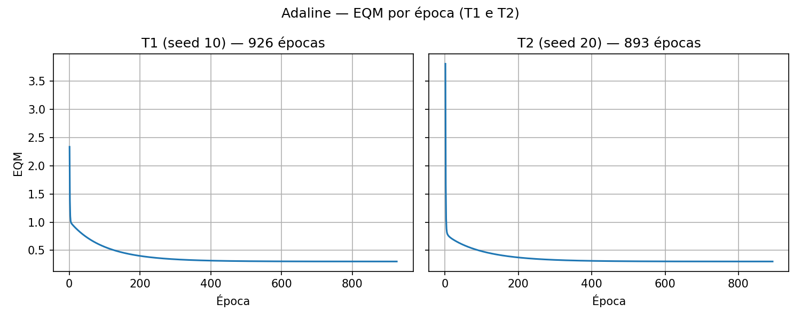

# Adaline — Respostas (Válvulas A/B)

## Item 1 — 5 treinamentos

- Modelo: `adaline/adaline_modelo.py` — 4 entradas + bias `x0 = -1`, `u = -w0 + x1*w1 + x2*w2 + x3*w3 + x4*w4`, ativação bipolar `y = +1 se u >= 0 senão -1` aplicada só em `prever()`.
- Regra Delta (LMS) online com erro linear `(d - u)`: sempre atualiza `w += eta*(d-u)*x` e `w0 += eta*(d-u)*(-1)`, com `eta = 0.0025`.
- Inicialização fora da classe, `U[0,1]`, gerador reiniciado por seed: T1=10, T2=20, T3=30, T4=40, T5=50.
- Dados: `data/adaline_treinamento.csv` (35 padrões do anexo).
- Parada: variação do EQM `|EQM_atual - EQM_anterior| < 1e-6` (teto `max_epocas = 1000`).
- Execução: `python3 -m adaline.adaline_treino` (`executar_treinamentos()`).

## Item 2 — Vetores de pesos e épocas

Ordem da tabela: `w0 (= θ, bias com x0 = -1), w1, w2, w3, w4`. 4 casas decimais.

| Treinamento | w0i | w1i | w2i | w3i | w4i | w0f | w1f | w2f | w3f | w4f | Épocas |
|---|---:|---:|---:|---:|---:|---:|---:|---:|---:|---:|---:|
| T1 (seed 10) | 0.4985 | 0.7713 | 0.0208 | 0.6336 | 0.7488 | -1.8131 | 1.3129 | 1.6423 | -0.4276 | -1.1778 | 926 |
| T2 (seed 20) | 0.0359 | 0.5881 | 0.8977 | 0.8915 | 0.8158 | -1.8131 | 1.3129 | 1.6424 | -0.4276 | -1.1778 | 893 |
| T3 (seed 30) | 0.9626 | 0.6441 | 0.3807 | 0.6630 | 0.1637 | -1.8131 | 1.3129 | 1.6424 | -0.4276 | -1.1778 | 931 |
| T4 (seed 40) | 0.4504 | 0.4077 | 0.0554 | 0.7885 | 0.2873 | -1.8131 | 1.3129 | 1.6423 | -0.4276 | -1.1778 | 923 |
| T5 (seed 50) | 0.3773 | 0.4946 | 0.2281 | 0.2555 | 0.3963 | -1.8131 | 1.3129 | 1.6423 | -0.4278 | -1.1778 | 898 |

Todos os 5 treinamentos convergiram pelo critério de precisão sem atingir o teto de 1000 épocas.

## Item 3 — EQM por época (T1 e T2)

- Curvas geradas por `python3 -m adaline.adaline_graficos` a partir de `historico_eqm` (1 ponto por época), T1 = 926 épocas e T2 = 893 épocas.
- T1 (seed 10): EQM 2.337256 → 0.301998; T2 (seed 20): EQM 3.810701 → 0.301998 — decaimento típico do LMS até o mesmo patamar (~0.302).
- T2 parte de EQM maior por causa da inicialização distinta, mas converge ao mesmo mínimo (consistente com pesos finais iguais do item 2).

## Item 4 — Classificação das 15 amostras

Legenda: `-1 = válvula A`, `+1 = válvula B`. Execução: `python3 -m adaline.adaline_teste` (retreina T1–T5 com os mesmos seeds do item 2 e aplica `prever()` em `data/adaline_teste.csv`).

| Amostra | x1 | x2 | x3 | x4 | y(T1) | y(T2) | y(T3) | y(T4) | y(T5) |
|---|---:|---:|---:|---:|---:|---:|---:|---:|---:|
| 1 | 0.9694 | 0.6909 | 0.4334 | 3.4965 | -1 | -1 | -1 | -1 | -1 |
| 2 | 0.5427 | 1.3832 | 0.6390 | 4.0352 | -1 | -1 | -1 | -1 | -1 |
| 3 | 0.6081 | -0.9196 | 0.5925 | 0.1016 | 1 | 1 | 1 | 1 | 1 |
| 4 | -0.1618 | 0.4694 | 0.2030 | 3.0117 | -1 | -1 | -1 | -1 | -1 |
| 5 | 0.1870 | -0.2578 | 0.6124 | 1.7749 | -1 | -1 | -1 | -1 | -1 |
| 6 | 0.4891 | -0.5276 | 0.4378 | 0.6439 | 1 | 1 | 1 | 1 | 1 |
| 7 | 0.3777 | 2.0149 | 0.7423 | 3.3932 | 1 | 1 | 1 | 1 | 1 |
| 8 | 1.1498 | -0.4067 | 0.2469 | 1.5866 | 1 | 1 | 1 | 1 | 1 |
| 9 | 0.9325 | 1.0950 | 1.0359 | 3.3591 | 1 | 1 | 1 | 1 | 1 |
| 10 | 0.5060 | 1.3317 | 0.9222 | 3.7174 | -1 | -1 | -1 | -1 | -1 |
| 11 | 0.0497 | -2.0656 | 0.6124 | -0.6585 | -1 | -1 | -1 | -1 | -1 |
| 12 | 0.4004 | 3.5369 | 0.9766 | 5.3532 | 1 | 1 | 1 | 1 | 1 |
| 13 | -0.1874 | 1.3343 | 0.5374 | 3.2189 | -1 | -1 | -1 | -1 | -1 |
| 14 | 0.5060 | 1.3317 | 0.9222 | 3.7174 | -1 | -1 | -1 | -1 | -1 |
| 15 | 1.6375 | -0.7911 | 0.7537 | 0.5515 | 1 | 1 | 1 | 1 | 1 |

Os 5 modelos concordaram em todas as 15 amostras (8 em A, 7 em B).

## Item 5 — Por que os pesos finais são iguais com épocas diferentes

Porque a Regra Delta minimiza o EQM, cuja superfície de erro é quadrática com um único mínimo global (solução de mínimos quadrados). Partindo de inits distintos (`U[0,1]`), cada treino percorre trajetória distinta até satisfazer `|ΔEQM| < 1e-6` — daí as épocas 893–931 — mas chega ao mesmo `w* ≈ [-1.8131, 1.3129, 1.6423, -0.4276, -1.1778]`. Prova no próprio trabalho: item 2 (pesos finais iguais), item 3 (EQM → ~0.302) e item 4 (consenso total nas 15 amostras).
