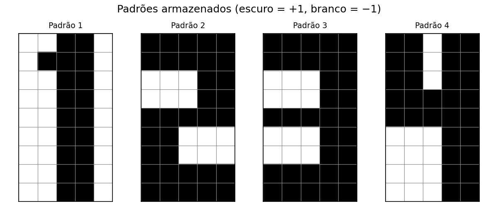
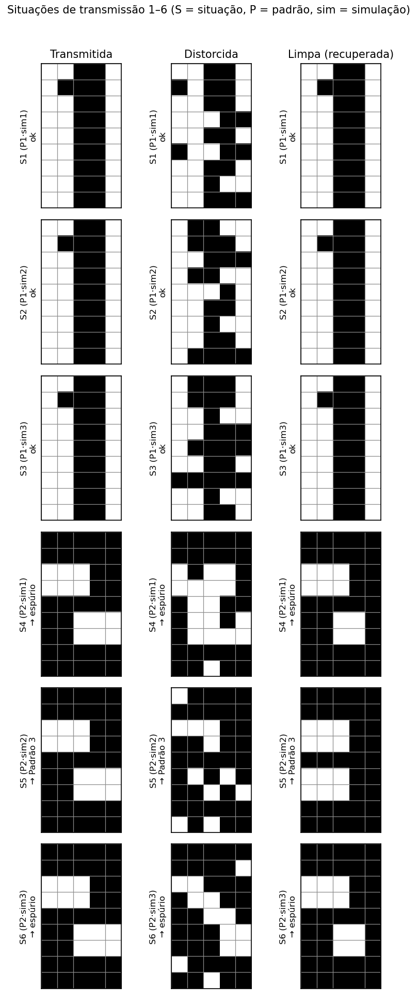
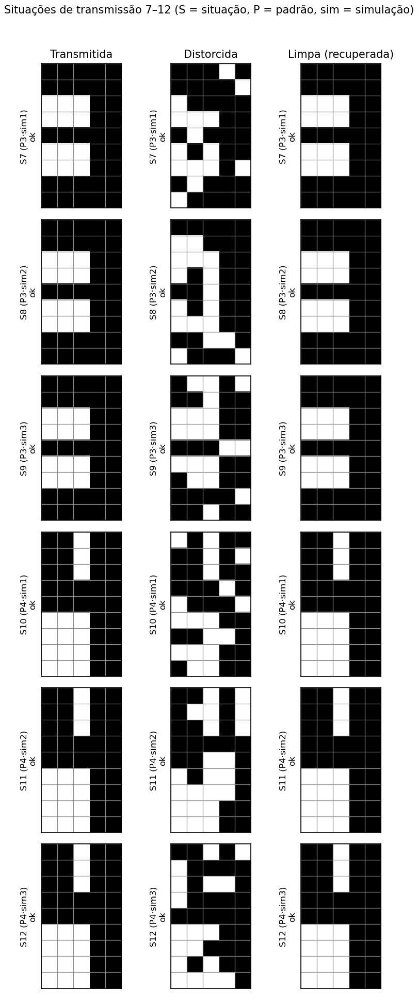
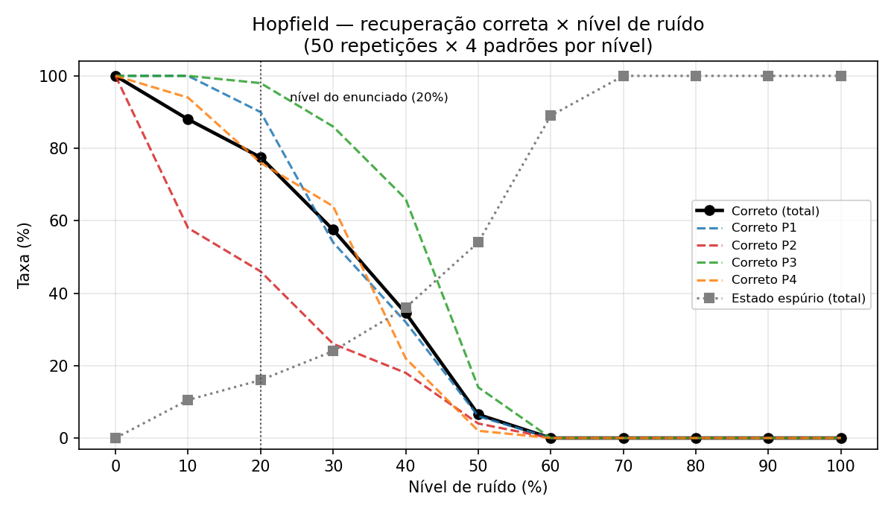

# Hopfield — Respostas (Memória associativa 45 bits)

## Item 1 — Simulação das 12 situações de transmissão

- Modelo: `hopfield_kohonen/hopfield/hopfield_modelo.py` — 45 neurônios (grade 9×5 lida linha a linha), branco = −1 e escuro = +1.
- Armazenamento pela **regra do produto externo** na forma clássica: `W = (1/45)·Σ_k x_k·x_kᵀ` com diagonal nula (`w_ii = 0`).
- Ativação: **tangente hiperbólica com β muito grande** (`y = tanh(β·net)`, β = 1000) — satura em ±1, comportando-se como a função sinal pedida no enunciado.
- Recuperação **assíncrona**: a cada varredura os 45 neurônios são visitados em ordem aleatória (seed 10 fixo) e atualizados um a um (`s_i ← tanh(β·Σ_j w_ij·s_j)`); para quando uma varredura inteira não altera nenhum neurônio. Energia `E = −½·sᵀWs` registrada a cada varredura.
- Dados: `hopfield_kohonen/data/hopfield_treinamento.csv` (4 padrões, conferidos célula a célula com as figuras do PDF) e `hopfield_kohonen/data/hopfield_teste.csv` (12 situações, 3 por padrão, cada uma com exatamente 9/45 = 20% dos pixels corrompidos).
- Execução: `python3 -m hopfield_kohonen.hopfield.hopfield_treino` (`executar_recuperacoes()`).

Resumo das 12 situações (estado final, varreduras até estabilizar e energia inicial → final):

| Situação | Padrão | Sim | Corrompidos | Recuperou o original? | Estado final | Varreduras | E inicial | E final |
|---:|---:|---:|---:|---|---|---:|---:|---:|
| 1 | 1 | 1 | 9 (20%) | sim | Padrão 1 | 2 | −6.7556 | −21.3333 |
| 2 | 1 | 2 | 9 (20%) | sim | Padrão 1 | 2 | −6.9333 | −21.3333 |
| 3 | 1 | 3 | 9 (20%) | sim | Padrão 1 | 2 | −6.3111 | −21.3333 |
| 4 | 2 | 1 | 9 (20%) | **não** | espúrio (2 px do P2) | 3 | −13.1556 | −30.6667 |
| 5 | 2 | 2 | 9 (20%) | **não** | Padrão 3 | 3 | −14.1333 | −33.8667 |
| 6 | 2 | 3 | 9 (20%) | **não** | espúrio (2 px do P2) | 2 | −7.8222 | −30.6667 |
| 7 | 3 | 1 | 9 (20%) | sim | Padrão 3 | 2 | −12.5333 | −33.8667 |
| 8 | 3 | 2 | 9 (20%) | sim | Padrão 3 | 2 | −10.7556 | −33.8667 |
| 9 | 3 | 3 | 9 (20%) | sim | Padrão 3 | 2 | −10.4889 | −33.8667 |
| 10 | 4 | 1 | 9 (20%) | sim | Padrão 4 | 2 | −6.9333 | −24.8889 |
| 11 | 4 | 2 | 9 (20%) | sim | Padrão 4 | 2 | −7.5556 | −24.8889 |
| 12 | 4 | 3 | 9 (20%) | sim | Padrão 4 | 2 | −9.3333 | −24.8889 |

Resultado: **9/12 situações recuperam o padrão original**; as 3 que falham são todas do padrão 2 (análise no item 3). Em todas as situações a energia **diminui** (ex.: S1: −6.7556 → −21.3333), confirmando a descida para um mínimo da função energia. A taxa 75% do conjunto fixo do CSV é compatível com a taxa estatística medida no item 3 para ruído de 20% (77.5%).

## Item 2 — Imagem distorcida → imagem limpa recuperada

Exemplo (S1, padrão 1) no formato do enunciado (`#` = escuro, `.` = branco):

```text
Transmitida   Distorcida   Limpa
..##.   ..##.   ..##.
.###.   #.##.   .###.
..##.   ..##.   ..##.
..##.   ...##   ..##.
..##.   ..##.   ..##.
..##.   #..##   ..##.
..##.   ..##.   ..##.
..##.   ..#..   ..##.
..##.   ..###   ..##.
```

As figuras abaixo (geradas por `python3 -m hopfield_kohonen.hopfield.hopfield_graficos`) mostram o trio completo das 12 situações — coluna "Limpa" mostra o estado final real da rede, inclusive quando ele NÃO é o padrão original:







Leitura dos resultados:

- **S1–S3 (P1), S7–S9 (P3), S10–S12 (P4):** recuperação perfeita — a imagem limpa é idêntica à transmitida, em 2–3 varreduras.
- **S4 e S6 (P2):** a rede estabiliza num estado espúrio que está a **apenas 2 pixels do P2** (visualmente quase idêntico), com energia −30.6667.
- **S5 (P2):** a rede converge para o **padrão 3** (energia −33.8667).

## Item 3 — O que acontece quando aumentamos excessivamente o nível de ruído

Experimento (`python3 -m hopfield_kohonen.hopfield.hopfield_teste`): varredura de ruído de 0% a 100% (passos de 10%), 50 repetições × 4 padrões por nível (seeds 100–149; ordem assíncrona com seed 10).

Taxa agregada por nível:

| Nível | Correto | Outro padrão | Espúrio | Não convergiu | Varreduras (média) |
|---:|---:|---:|---:|---:|---:|
| 0% | 100.0% | 0.0% | 0.0% | 0.0% | 1.0 |
| 10% | 88.0% | 1.5% | 10.5% | 0.0% | 2.0 |
| 20% | 77.5% | 6.5% | 16.0% | 0.0% | 2.1 |
| 30% | 57.5% | 18.5% | 24.0% | 0.0% | 2.3 |
| 40% | 34.5% | 29.5% | 36.0% | 0.0% | 2.5 |
| 50% | 6.5% | 39.5% | 54.0% | 0.0% | 2.6 |
| 60% | 0.0% | 11.0% | 89.0% | 0.0% | 2.5 |
| 70% | 0.0% | 0.0% | 100.0% | 0.0% | 2.2 |
| 80% | 0.0% | 0.0% | 100.0% | 0.0% | 2.1 |
| 90% | 0.0% | 0.0% | 100.0% | 0.0% | 2.0 |
| 100% | 0.0% | 0.0% | 100.0% | 0.0% | 1.0 |

Taxa de acerto por padrão (%) evidencia a fragilidade do P2:

| Nível | P1 | P2 | P3 | P4 |
|---:|---:|---:|---:|---:|
| 0% | 100 | 100 | 100 | 100 |
| 10% | 100 | 58 | 100 | 94 |
| 20% | 90 | 46 | 98 | 76 |
| 30% | 54 | 26 | 86 | 64 |
| 40% | 32 | 18 | 66 | 22 |
| 50% | 6 | 4 | 14 | 2 |
| 60%–100% | 0 | 0 | 0 | 0 |



**Por que isso acontece.** Os padrões armazenados são mínimos da energia `E = −½·sᵀWs`, e a recuperação é a dinâmica de descer a energia a partir do estado inicial. Com pouco ruído a entrada continua na bacia de atração do padrão correto e o estado desliza até ele em 2–3 varreduras. Conforme o ruído cresce, três efeitos aparecem em sequência:

1. **Interferência entre padrões (crosstalk).** A regra do produto externo soma `x_k·x_kᵀ` de todos os padrões; os produtos cruzados de padrões correlacionados criam mínimos extras. Nos nossos 4 padrões, o par crítico é P2–P3: `m23 = 0.644` (diferem em só 8 dos 45 pixels), contra `m12 = −0.156`, `m13 = +0.022`, `m14 = −0.111`, `m24 = +0.067`, `m34 = +0.422`. Por isso P2 é o mínimo mais raso (`E(P1) = −21.3333`, `E(P2) = −30.4889`, `E(P3) = −33.8667`, `E(P4) = −24.8889`): com 20% de ruído P2 já cai para 46% de acerto — as 3 falhas do item 1 são exatamente isso (S4/S6: mínimo espúrio "quase-P2", 2 pixels de distância e energia −30.6667, *mais fundo* que o próprio P2; S5: trajetória atravessa para a bacia do P3, que é mais fundo). Todas as 12 entradas tinham o próprio padrão como mais próximo (`d = 9`; o segundo mais próximo fica a ≥ 11) — a falha é da dinâmica/energia, não da distância.
2. **Zona de colapso em ~50%.** Com metade dos pixels invertidos a entrada fica equidistante do padrão e do seu complemento: como `w_ii = 0`, `E(−s) = E(s)` e a rede "armazena" também o complemento de cada padrão, além de estados mistura (combinações lineares dos padrões armazenados). Em 50% o acerto despenca para 6.5% e os estados mistura dominam ("outro padrão" + "espúrio" ≈ 93.5%).
3. **Ruído excessivo (≥ 60%): recuperação zero.** A entrada fica mais próxima de estados espúrios do que de qualquer padrão; entre 70% e 100% a rede sempre estabiliza fora dos padrões originais. Em 100% a entrada é o próprio complemento `−P`, que é ponto fixo com a mesma energia de `P` (por isso converge em 1 varredura) — a rede recupera "a imagem negativa", inútil para a transmissão.

Em resumo: a memória associativa só é confiável enquanto o ruído mantém a entrada dentro da bacia de atração correta (aqui, na prática, até ~20–30%, dependendo do padrão). Excesso de ruído joga o estado para mínimos espúrios (misturas) ou para o complemento — a energia continua diminuindo, mas para o "lugar errado". Estruturalmente a rede suportaria até `≈ 0.138 × 45 ≈ 6` padrões quase ortogonais; o gargalo deste exercício não é a capacidade (4 < 6), e sim a alta correlação P2–P3.

### Notas técnicas

- Diagonal de W: a formulação clássica (com garantia de descida de energia) usa `w_ii = 0`, adotada aqui. Mantendo a diagonal (`w_ii = 1/45`), apenas S6 passa a recuperar (10/12) — S4 e S5 falham em **qualquer** variante testada (diagonal mantida, atualização síncrona, 50 seeds de ordem diferentes).
- O exemplo do próprio enunciado (padrão 3 com 10 pixels invertidos = 22%) é recuperado corretamente por esta implementação.
- `lembrar()` usa `np.random.default_rng(seed)` isolado para a ordem assíncrona, sem alterar o gerador global (`np.random.seed`) usado pelo sorteio de ruído — tudo reproduzível.
