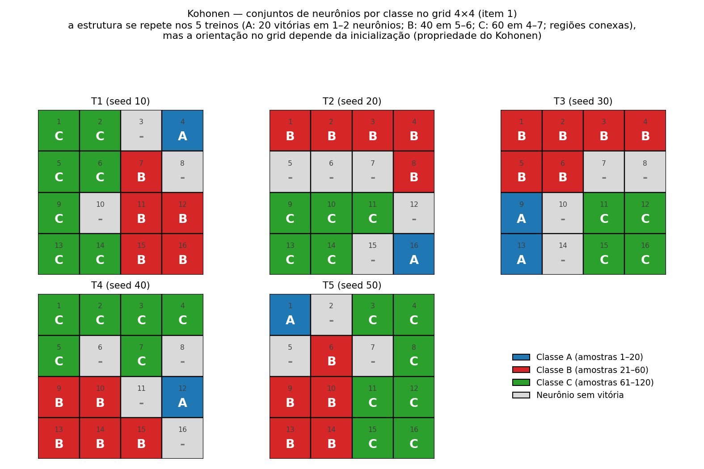
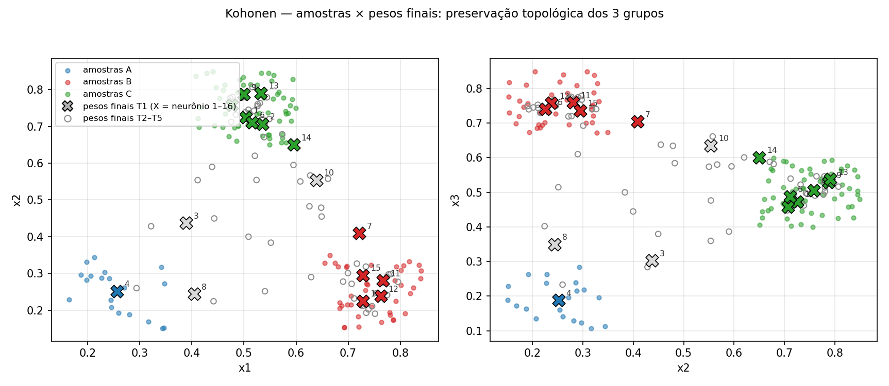
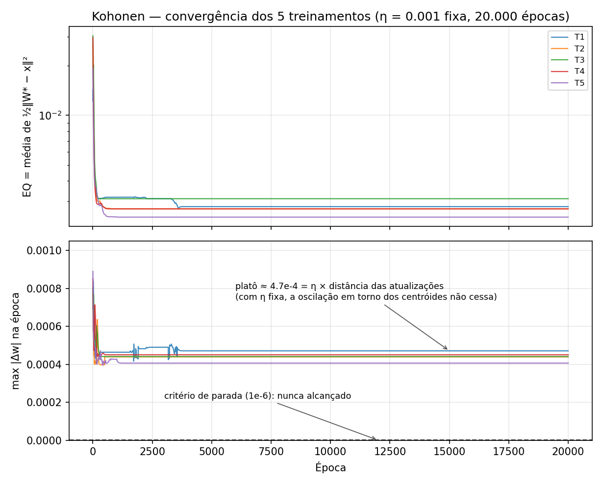

# Kohonen — Respostas (Mapa auto-organizável 4×4, 16 neurônios)

## Formulação implementada

- Modelo: `hopfield_kohonen/kohonen/kohonen_modelo.py` — classe `Kohonen` pura (numpy), 16 neurônios em grade 4×4 numerados 1–16 linha a linha, cada um com 3 pesos `{w1, w2, w3}`.
- **Vencedor**: neurônio `j*` com menor **norma euclidiana** `‖W_j − x‖` (`np.argmin` resolve empates pelo menor índice).
- **Vizinhança (raio 1)**: distância euclidiana entre as *coordenadas do grid* ≤ 1 — o vencedor + os 4 vizinhos ortogonais (norte/sul/leste/oeste), todos com `h = 1`.
- **Atualização** (regra “Norma Euclidiana”): `W_j ← W_j + η·(x − W_j)` com **η = 0.001 fixa** (o enunciado não pede decaimento).
- **Época**: as 120 amostras apresentadas **na ordem do arquivo** (A = 1–20, B = 21–60, C = 61–120). A cada época a rede registra o erro médio de quantização `EQ = média de ½‖W_{j*} − x‖²` e a maior variação de peso da época (`max |Δw|`).
- **Inicialização**: pesos `U[0,1]` sorteados **fora da classe**, no script, com `np.random.seed(seed)` — 5 treinamentos independentes **T1–T5** com seeds **10, 20, 30, 40, 50** (padrão do perceptron/adaline).
- **Parada**: `max |Δw|` da época < **1e-6**; teto de segurança de **20.000 épocas**. (Ver “Análise da convergência”: com η fixa o critério numérico não dispara e o treino termina no teto — comportamento explicado ali.)
- Dados: `hopfield_kohonen/data/kohonen_treinamento.csv` (120 amostras × 3 medidas, em [0.1, 0.85]; sem normalização, pois o enunciado não pede) e `hopfield_kohonen/data/kohonen_teste.csv` (as 12 amostras da tabela do item 2).
- Execução (da raiz do workspace): `python3 -m hopfield_kohonen.kohonen.kohonen_treino` → `...kohonen_teste` → `...kohonen_graficos`.

## Item 1 — Conjuntos de neurônios que respondem a A, B e C

Método (`mapear_rotulos`): apresenta as 120 amostras rotuladas ao mapa **treinado**; cada amostra “vota” no seu neurônio vencedor; a **classe dominante** de um neurônio é a classe com mais vitórias. Neurônio **sem nenhuma vitória** não responde a classe nenhuma.

A rede foi treinada 5 vezes (seeds 10–50). Resumo das execuções:

| Treino | Seed | Épocas | Parada | EQ inicial | EQ final | max\|Δw\| final | Última troca de vencedor |
|---|---:|---:|---|---:|---:|---:|---:|
| T1 | 10 | 20.000 | teto | 0.01433 | 0.00280 | 4.71e-04 | época 3667 |
| T2 | 20 | 20.000 | teto | 0.02587 | 0.00271 | 4.39e-04 | época 669 |
| T3 | 30 | 20.000 | teto | 0.03036 | 0.00312 | 4.41e-04 | época 353 |
| T4 | 40 | 20.000 | teto | 0.02957 | 0.00271 | 4.50e-04 | época 525 |
| T5 | 50 | 20.000 | teto | 0.01928 | 0.00241 | 4.06e-04 | época 1009 |

Em **todos** os treinos as atribuições (qual amostra cada neurônio vence) congelam cedo — entre as épocas 353 e 3667 — e o EQ estabiliza por volta da época 5.000.

Mapa do **T1** (treinamento representativo):

```text
 C  C  -  A
 C  C  B  -
 C  -  B  B
 C  C  B  B
```

**Resposta (T1):** a classe **A** responde no conjunto **{4}** (as 20 amostras A); a classe **B** no conjunto **{7, 11, 12, 15, 16}** (as 40 amostras B); a classe **C** no conjunto **{1, 2, 5, 6, 9, 13, 14}** (as 60 amostras C); os neurônios **{3, 8, 10}** não vencem nenhuma amostra — não respondem a classe alguma.

Os pesos finais do T1 (4 decimais) mostram os centróides de cada região:

| Neurônio | w1 | w2 | w3 | Vitórias A/B/C | Dominante |
|---:|---:|---:|---:|---:|---|
| 1 | 0.5033 | 0.7249 | 0.4733 | 0/0/5 | C |
| 2 | 0.5355 | 0.7068 | 0.4581 | 0/0/14 | C |
| 3 | 0.3887 | 0.4373 | 0.3032 | 0/0/0 | — |
| 4 | 0.2557 | 0.2518 | 0.1887 | 20/0/0 | A |
| 5 | 0.4764 | 0.7579 | 0.5052 | 0/0/12 | C |
| 6 | 0.5157 | 0.7114 | 0.4879 | 0/0/5 | C |
| 7 | 0.7211 | 0.4089 | 0.7047 | 0/1/0 | B |
| 8 | 0.4045 | 0.2441 | 0.3497 | 0/0/0 | — |
| 9 | 0.4997 | 0.7878 | 0.5288 | 0/0/8 | C |
| 10 | 0.6390 | 0.5540 | 0.6356 | 0/0/0 | — |
| 11 | 0.7666 | 0.2802 | 0.7594 | 0/13/0 | B |
| 12 | 0.7627 | 0.2380 | 0.7581 | 0/7/0 | B |
| 13 | 0.5325 | 0.7911 | 0.5375 | 0/0/13 | C |
| 14 | 0.5950 | 0.6501 | 0.6014 | 0/0/3 | C |
| 15 | 0.7283 | 0.2951 | 0.7367 | 0/6/0 | B |
| 16 | 0.7277 | 0.2250 | 0.7401 | 0/13/0 | B |

Estrutura dos 5 mapas — o que **se repete** em todos os treinos:

| Treino | Classe A | Classe B | Classe C | Sem resposta | Regiões conexas |
|---|---|---|---|---|---|
| T1 | 1: {4} | 5: {7, 11, 12, 15, 16} | 7: {1, 2, 5, 6, 9, 13, 14} | 3: {3, 8, 10} | sim |
| T2 | 1: {16} | 5: {1, 2, 3, 4, 8} | 5: {9, 10, 11, 13, 14} | 5: {5, 6, 7, 12, 15} | sim |
| T3 | 2: {9, 13} | 6: {1–6} | 4: {11, 12, 15, 16} | 4: {7, 8, 10, 14} | sim |
| T4 | 1: {12} | 5: {9, 10, 13, 14, 15} | 6: {1, 2, 3, 4, 5, 7} | 4: {6, 8, 11, 16} | sim |
| T5 | 1: {1} | 5: {6, 9, 10, 13, 14} | 7: {3, 4, 8, 11, 12, 15, 16} | 3: {2, 5, 7} | sim |



**Leitura dos resultados (importante):**

- Em todos os treinos as 20 amostras A caem em **1 neurônio** (no T3, 2 neurônios: 6 + 14), as 40 B em **5–6 neurônios** e as 60 C em **4–7**; sempre formando **regiões conexas** do grid (o mapa preserva a topologia: cada classe ocupa um bloco, e os neurônios “mortos” ficam nas bordas entre blocos).
- A **posição/orientação** dessas regiões no grid, porém, **muda com a inicialização** (T1 vs T5: 0/16 células iguais; máx. 6/16 entre pares). Isso é uma propriedade conhecida do Kohonen: a topologia é preservada, mas a orientação absoluta do mapa não é canônica — depende de onde cada neurônio “nasce” no espaço de entrada.
- A estabilidade real aparece no **espaço de pesos**: o neurônio que responde a A converge para o **mesmo vetor nos 5 treinos** — `(0.2557, 0.2518, 0.1887)` — porque vence sempre as mesmas 20 amostras A na mesma ordem (mesmo ciclo-limite da regra com η fixa). Os pesos dos neurônios de B ficam com `x1, x3` altos e `x2` baixo; os de C com `x2` alto — dentro das caixas das respectivas classes (ver dispersão abaixo).
- **Neurônios sem vitória**: com 3 grupos bem separados e vizinhança fixa de raio 1, os neurônios que “nascem” nas zonas de fronteira vazias (entre os blocos) nunca se tornam o mais próximo de nenhuma amostra — sua região é absorvida pelos vizinhos. É o fenômeno clássico de neurônios subutilizados quando não há fase de “annealing” (raio/η decrescentes), que o enunciado não pede.

## Item 2 — Classificação das 12 amostras de teste

Método: apresenta cada amostra a cada um dos 5 mapas treinados; o **vencedor** (menor norma euclidiana) indica a classe pela sua classe dominante (item 1).

| Amostra | x1 | x2 | x3 | T1 | T2 | T3 | T4 | T5 | Consenso |
|---:|---:|---:|---:|---|---|---|---|---|---|
| 1 | 0.2471 | 0.1778 | 0.2905 | A | A | A | A | A | **A** |
| 2 | 0.8240 | 0.2223 | 0.7041 | B | B | B | B | B | **B** |
| 3 | 0.4960 | 0.7231 | 0.5866 | C | C | C | C | C | **C** |
| 4 | 0.2923 | 0.2041 | 0.2234 | A | A | A | A | A | **A** |
| 5 | 0.8118 | 0.2668 | 0.7484 | B | B | B | B | B | **B** |
| 6 | 0.4837 | 0.8200 | 0.4792 | C | C | C | C | C | **C** |
| 7 | 0.3248 | 0.2629 | 0.2375 | A | A | A | A | A | **A** |
| 8 | 0.7209 | 0.2116 | 0.7821 | B | B | B | B | B | **B** |
| 9 | 0.5259 | 0.6522 | 0.5957 | C | C | C | C | C | **C** |
| 10 | 0.2075 | 0.1669 | 0.1745 | A | A | A | A | A | **A** |
| 11 | 0.7830 | 0.3171 | 0.7888 | B | B | B | B | B | **B** |
| 12 | 0.5393 | 0.7510 | 0.5682 | C | C | C | C | C | **C** |

**Resultado: 4 A (1, 4, 7, 10), 4 B (2, 5, 8, 11) e 4 C (3, 6, 9, 12), com unanimidade nos 5 treinamentos** — embora a orientação do grid mude entre treinos (as amostras A vencem no neurônio 4 no T1, 16 no T2, 9/13 no T3, 12 no T4 e 1 no T5), a **classe atribuída é sempre a mesma**, porque as regiões no espaço de pesos são estáveis. A classificação também é coerente com a assinatura das coordenadas vista no treino: A = tudo baixo, B = `x1,x3` altos e `x2` baixo, C = `x2` alto.



## Item 3 — Demonstração: a regra “Norma Euclidiana” como minimização do erro quadrático

Para um padrão `x` e o neurônio **vencedor** `j`, o enunciado define a função de erro quadrático (imagem da página 2 do PDF):

```text
E(W_j) = 1/2 · Σ_i (w_ji − x_i)²  =  1/2 · ‖W_j − x‖²
```

**Passo 1 — gradiente.** No somatório, apenas o termo `i` contém o peso `w_ji` — os termos `k ≠ i` não dependem de `w_ji` e derivam zero. Derivando o termo restante:

```text
∂E/∂w_ji = ∂/∂w_ji [ 1/2 · (w_ji − x_i)² ]
         = 1/2 · 2 · (w_ji − x_i) · ∂w_ji/∂w_ji
         = w_ji − x_i
```

Logo, em forma vetorial, `∇E = W_j − x`.

**Passo 2 — descida de gradiente.** Para **minimizar** `E`, atualiza-se cada peso na direção do **negativo do gradiente**, com taxa de aprendizado `η`:

```text
w_ji(t+1) = w_ji(t) − η · ∂E/∂w_ji
          = w_ji(t) − η · (w_ji(t) − x_i)
          = w_ji(t) + η · (x_i − w_ji(t))
```

Em forma vetorial:

```text
W_j(t+1) = W_j(t) + η · (x − W_j(t))
```

que é **exatamente** a regra de alteração de pesos “Norma Euclidiana” usada na implementação (`W[conjunto] += eta * (x - W[conjunto])`).

**Por que o nome.** `E = ½·‖W_j − x‖²` é metade do **quadrado da norma euclidiana** do vetor de erro `W_j − x`. Minimizar `E` equivale a minimizar a distância euclidiana entre o peso e o padrão; e o passo de descida, `ΔW_j = η·(x − W_j)`, é **paralelo a `(x − W_j)`** — o peso caminha em linha reta na direção do padrão, reduzindo a norma euclidiana da diferença a cada apresentação, de fração `η` por vez.

**O passo sempre reduz o erro (para 0 < η < 2).** Com `d = W_j(t) − x`, o novo peso é `W_j(t+1) = W_j(t) − η·d`, e o novo erro é `E(t+1) = ½·(1−η)²·‖d‖²`. Portanto:

```text
E(t+1) − E(t) = ½·[(1−η)² − 1]·‖d‖² = −η·(1 − η/2)·‖d‖²  < 0
```

Com `η = 0.001`, cada apresentação ao vencedor reduz `E` em `≈ 0.0009995·‖d‖²` — descida de gradiente garantida, lenta e estável.

**Observação sobre a vizinhança.** A demonstração vale para o vencedor `j` (o único que “sobra” na competição). No Kohonen, os vizinhos do vencedor recebem a **mesma regra** com fator de vizinhança `h = 1` — uma cooperação que arrasta os vizinhos junto com o vencedor e é o que faz o grid preservar a topologia dos dados (regiões conexas por classe).

## Análise da convergência (e por que o treino termina no teto de 20.000 épocas)



- O **EQ cai rápido** no começo (0.014–0.030 → ~0.003 nas primeiras centenas de épocas) e estabiliza por volta da época 5.000 — as regiões/atribuições congelam entre as épocas 353 e 3667, bem antes do teto.
- O **critério de parada `max |Δw| < 1e-6` nunca dispara**: o `max |Δw|` por época estabiliza num **platô de ≈ 4.1–4.7e-4**. A razão é estrutural: com **η fixa**, cada atualização move o peso `η·(x − W)`, e a rede atinge um **ciclo-limite** — os pesos oscilam em torno dos centróides das suas regiões em vez de parar exatamente neles. A amplitude da oscilação é da ordem de `η × distância das atualizações`, dominada pelos neurônios de fronteira (incluindo os “mortos”), que são arrastados pelos vencedores vizinhos para longe do próprio peso. Como `η` não decai, essa oscilação não cessa — diferente do Adaline, cujo critério por variação do EQM dispara quando os pesos convergem. O **teto de 20.000 épocas** é, na prática, a parada efetiva; o mapa já está estável há milhares de épocas.
- Esse comportamento é fiel à formulação do enunciado (η = 0.001, sem decaimento). Com a prática usual de annealing (η e raio decrescentes) o platô tenderia a zero e o critério numérico dispararia — não é o caso pedido.

## Notas técnicas

- Interpretamos “raio de vizinhança igual a 1” como **distância euclidiana ≤ 1 entre as coordenadas do grid** → vencedor + 4 ortogonais (cantos têm 2 vizinhos, bordas 3, interior 4, além do próprio vencedor).
- Sem normalização dos dados (valores já em [0.1, 0.85]); distâncias euclidianas diretas.
- Empates no vencedor: `np.argmin` escolhe o menor índice. Empate de classes dominantes não ocorreu nos 5 treinos (o reparte 6/14 do T3 entre n9/n13 não é empate: ambos os neurônios respondem só a A).
- Inicialização `U[0,1]` **fora da classe**, no script, com `np.random.seed(seed)` (T1–T5: seeds 10–50) — mesmo padrão do perceptron/adaline; tudo reproduzível.
- Os 12 vencedores por amostra/treino estão na saída de `kohonen_teste`; a discordância de neurônio entre treinos para a mesma amostra é a manifestação da orientação variável do mapa (a classe, não).
