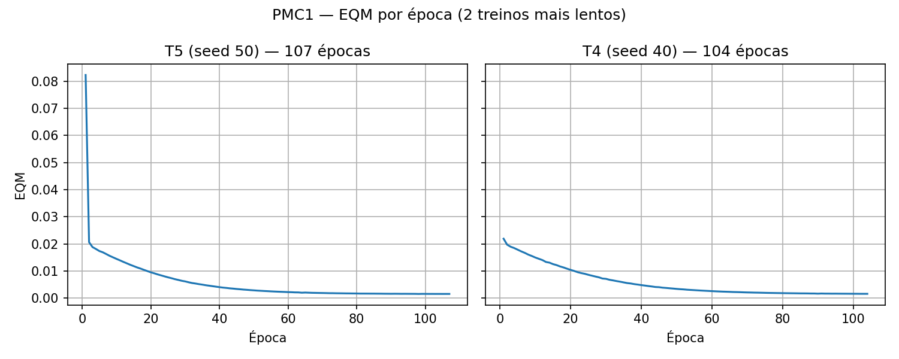

# PMC1 — Ressonância magnética (3 → 10 → 1, backpropagation)

> Topologia do PDF: 3 entradas → 10 neurônios ocultos → 1 saída `y`
> (MLP clássico, **sem** o atalho W3 do exercício anterior).
> Config: logística em todos os neurônios, `eta = 0.1`, parada `|EQM_e − EQM_e−1| < 1e−6`, teto 5000 épocas.
> Pesos iniciais `U[0,1]`, seeds `10,20,30,40,50` (T1–T5).
> Dados: `data/conjunto_treinamento.csv` (200 padrões = Anexo do PDF, conferido linha a linha)
> e `data/conjunto_validacao.csv` (20 padrões = tabela do item 5). Código em `pmc1/`.

## 1. Treinamentos executados

`pmc1/pmc1_treino.py:executar_5_treinamentos()` — modo estocástico (embaralha os 200 a cada época),
`pmc1/pmc1_modelo.py:backward_step()` com `delta_o=(d−o)o(1−o)`, `delta_h=y_h(1−y_h)delta_o·W2_antigo`.
Cada `T` guarda os pesos só em memória (sem `.npz`) e salva o histórico em
`pmc1/resultados/eqm_T*.csv`. Rodar: `.venv/bin/python -m pmc1.pmc1_treino`.

## 2. Tabela — EQM final × épocas

| Treinamento | Erro Quadrático Médio | Número de Épocas |
|---|---|---|
| 1º (T1, seed 10) | 0.001683 | 87 |
| 2º (T2, seed 20) | 0.001946 | 71 |
| 3º (T3, seed 30) | 0.001624 | 96 |
| 4º (T4, seed 40) | 0.001594 | 104 |
| 5º (T5, seed 50) | 0.001557 | 107 |

Critério de parada atingido em todos (ΔEQM < 1e−6 antes do teto 5000).

## 3. Gráficos EQM × época (2 mais lentos: T5 e T4)

`pmc1/pmc1_graficos.py` → `docs/answers/pmc1_eqm_lentos.png` (mesma folha, lado a lado, não superpostos):

Curva típica: queda rápida nas ~20 primeiras épocas e cauda longa até o ΔEQM encostar em 1e−6.

## 4. Por que EQM e épocas variam entre T1–T5?

1. **Ponto de partida diferente.** Cada T sorteia `W1[3×10], W2[10], b1[10], b2` em `U[0,1]` com seed distinta. A superfície de erro do MLP é não-convexa (múltiplos mínimos locais, platôs e vales por causa da sigmoide); cada init cai numa bacia diferente.
2. **Simetria quebrada de outro jeito.** Com 10 ocultos, cada init especializa neurônios diferentes para regiões do espaço `x1,x2,x3` — uns já nascem perto de uma boa solução (T2: 71 épocas), outros atravessam platô de sigmoide saturada onde `o(1−o)≈0` e o gradiente quase zera (T5: 107 épocas).
3. **Ordem estocástica.** O embaralhamento `permutation()` por época depende do estado do RNG após o init, logo cada T vê os 200 padrões em ordem diferente — trajetórias de gradiente distintas mesmo com mesmo `eta`.
4. **EQM final ≠ mesmo mínimo.** T2 parou em 0.001946 (mínimo local pior), T5 em 0.001557 (bacia melhor). Parada por ΔEQM congela quando a melhora estagna, não quando chega ao ótimo global — por isso 5 inits são o procedimento correto do item 1.

## 5. Validação — 20 padrões de teste

Erro relativo por padrão: `ER = |d − yrede| / |d| × 100 (%)`. `ERM` = média dos 20; `Variância` = `var(ER)` populacional.
`pmc1/pmc1_teste.py:avaliar()` — rodar: `.venv/bin/python -m pmc1.pmc1_teste`.

| Amostra | x1 | x2 | x3 | d | yrede(T1) | yrede(T2) | yrede(T3) | yrede(T4) | yrede(T5) |
|---|---|---|---|---|---|---|---|---|---|
| 1 | 0.0611 | 0.2860 | 0.7464 | 0.4831 | 0.4926 | 0.5047 | 0.4942 | 0.4972 | 0.4901 |
| 2 | 0.5102 | 0.7464 | 0.0860 | 0.5965 | 0.5977 | 0.5932 | 0.5969 | 0.5988 | 0.5965 |
| 3 | 0.0004 | 0.6916 | 0.5006 | 0.5318 | 0.5331 | 0.5390 | 0.5346 | 0.5376 | 0.5319 |
| 4 | 0.9430 | 0.4476 | 0.2648 | 0.6843 | 0.7073 | 0.6982 | 0.7076 | 0.7092 | 0.7094 |
| 5 | 0.1399 | 0.1610 | 0.2477 | 0.2872 | 0.3090 | 0.3186 | 0.3002 | 0.3029 | 0.3011 |
| 6 | 0.6423 | 0.3229 | 0.8567 | 0.7663 | 0.7504 | 0.7457 | 0.7532 | 0.7555 | 0.7567 |
| 7 | 0.6492 | 0.0007 | 0.6422 | 0.5666 | 0.5742 | 0.5795 | 0.5756 | 0.5766 | 0.5712 |
| 8 | 0.1818 | 0.5078 | 0.9046 | 0.6601 | 0.6782 | 0.6789 | 0.6822 | 0.6843 | 0.6821 |
| 9 | 0.7382 | 0.2647 | 0.1916 | 0.5427 | 0.5414 | 0.5422 | 0.5401 | 0.5413 | 0.5371 |
| 10 | 0.3879 | 0.1307 | 0.8656 | 0.5836 | 0.6049 | 0.6117 | 0.6083 | 0.6099 | 0.6048 |
| 11 | 0.1903 | 0.6523 | 0.7820 | 0.6950 | 0.6894 | 0.6874 | 0.6927 | 0.6950 | 0.6937 |
| 12 | 0.8401 | 0.4490 | 0.2719 | 0.6790 | 0.6760 | 0.6691 | 0.6764 | 0.6780 | 0.6769 |
| 13 | 0.0029 | 0.3264 | 0.2476 | 0.2956 | 0.3172 | 0.3268 | 0.3085 | 0.3122 | 0.3092 |
| 14 | 0.7088 | 0.9342 | 0.2763 | 0.7742 | 0.7809 | 0.7665 | 0.7805 | 0.7819 | 0.7863 |
| 15 | 0.1283 | 0.1882 | 0.7253 | 0.4662 | 0.4735 | 0.4861 | 0.4742 | 0.4771 | 0.4698 |
| 16 | 0.8882 | 0.3077 | 0.8931 | 0.8093 | 0.8146 | 0.8062 | 0.8167 | 0.8199 | 0.8246 |
| 17 | 0.2225 | 0.9182 | 0.7820 | 0.7581 | 0.7762 | 0.7663 | 0.7778 | 0.7807 | 0.7834 |
| 18 | 0.1957 | 0.8423 | 0.3085 | 0.5826 | 0.5950 | 0.5939 | 0.5958 | 0.5985 | 0.5951 |
| 19 | 0.9991 | 0.5914 | 0.3933 | 0.7938 | 0.7959 | 0.7831 | 0.7965 | 0.7986 | 0.8028 |
| 20 | 0.2299 | 0.1524 | 0.7353 | 0.5012 | 0.5031 | 0.5144 | 0.5046 | 0.5069 | 0.4999 |
| **Erro Relativo Médio (%)** | | | | | **2.010** | **2.891** | **1.829** | **2.150** | **1.812** |
| **Variância (%)** | | | | | **4.3730** | **8.5075** | **2.0880** | **2.8626** | **2.2954** |

## 6. Melhor generalização

**T5 (seed 50).** Menor ERM (1.812%) com segunda menor variância (2.2954) e também o menor EQM de treino (0.001557) — sem sinal de overfitting. T3 é o vice (ERM 1.829%, var 2.0880, a mais estável). T2 é o pior nos dois critérios (ERM 2.891%, var 8.5075 — mínimo local ruim do item 4). Para a ressonância, onde erro médio baixo **e** previsível importam, T5 é a escolha; T3 seria o backup conservador.
