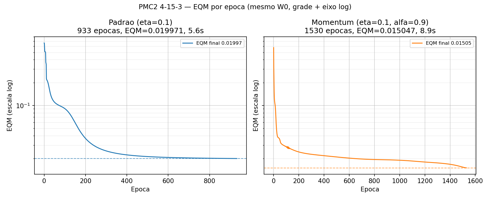

# PMC2 — Respostas (classificação de conservantes A/B/C)

## 1. O que a rede faz (conceito direto)
Entradas `x1..x4` → camada oculta (15 neurônios) → 3 saídas `y1 y2 y3`.
Cada neurônio faz `soma ponderada + sigmoid`. A sigmoid esmaga tudo para `(0,1)`,
por isso a saída pode ser lida como "grau de pertinência" a cada classe.
Classes: A=`100`, B=`010`, C=`001` (one-hot).

Arquitetura usada: **4-15-3 + bias** (15 vem da figura do PDF).
Pesos `W1 (5x15)` e `W2 (16x3)` — a linha extra é o bias (=1 fixo).

Aprendizado = repetir: `forward → erro (d-y) → backprop (regra da cadeia) → corrige pesos`.
`EQM = média((d-y)²)` sobre 130 padrões × 3 saídas. É o que monitoramos por época.

## 2. Configuração (itens 1 e 2)
| Item | Algoritmo | eta | alpha | eps (parada) | Pesos iniciais | Ativação |
|------|-----------|-----|-------|--------------|----------------|----------|
| 1 | Backprop padrão (online, padrão-por-padrão) | 0.1 | — | \|EQM_atual − EQM_ant\| < 1e-6, max 5000 épocas | U[0,1], seed 42 | sigmoid em tudo |
| 2 | Backprop com momentum | 0.1 | 0.9 | mesma | **mesma matriz W0 do item 1** (copiada) | sigmoid em tudo |

Conceito da diferença:
- **Padrão:** `dW = eta · gradiente`. Só olha o erro atual.
- **Momentum:** `dW(t) = eta · gradiente + alpha · dW(t-1)`. Soma uma fração
  da correção anterior = "inércia". Atravessa platôs/oscilações e costuma
  chegar a um mínimo melhor, às vezes com mais épocas até estabilizar
  (critério de parada é variação do EQM, não valor absoluto).

Código: `pmc.py` (só numpy) + `train_pmc2.py`. Sem lib de rede neural.

## 3. Resultado dos treinos
| Treino | Épocas | EQM final | Tempo |
|--------|--------|-----------|-------|
| Padrão | 933 | 0.01997 | ~6.2 s |
| Momentum (alfa 0.9) | 1530 | 0.01505 | ~10.2 s |

EQM inicial (W0): ~0.664. Ou seja, ambos caíram ~97-98%.
Gráfico (mesma folha, não superpostos): `eqm_pmc2.png`
(eixo Y em log + grade, mesma escala nos dois — é o que revela a diferença na cauda:
0.020 vs 0.015 some em escala linear 0–0.66).



Leitura: as duas curvas caem rápido no início e achatam no fim (típico da sigmoid
+ backprop). O momentum terminou com **EQM menor** (0.015 vs 0.020), mas precisou
de **mais épocas** aqui porque o critério é estabilização (`|dEQM|<1e-6`):
o momentum continua refinando com passos pequenos por mais tempo.

## 4. Pós-processamento (item 3)
A rede devolve reais (ex: 0.997, 0.002). Para classificar, arredondamento simétrico
**só no teste**:
```
y_pos = 1 se y >= 0.5, senão 0
```
Isso transforma `0.997/0.001/0.002 → 100 (tipo A)`, etc.

## 5. Validação nos 18 padrões de teste (item 4)
Critério: padrão conta como acerto só se as **3 saídas** baterem com o desejado.

Rede com momentum (a melhor em EQM) — 18/18:
| # | y1 y2 y3 (real) | pós | desejado | sit |
|---|-----------------|-----|----------|-----|
| 1 | 0.000 0.000 1.000 | 001 | 001 | OK |
| 2 | 1.000 0.000 0.000 | 100 | 100 | OK |
| 3 | 0.000 0.000 1.000 | 001 | 001 | OK |
| 4 | 0.001 0.999 0.000 | 010 | 010 | OK |
| 5 | 0.000 0.000 1.000 | 001 | 001 | OK |
| 6 | 0.987 0.010 0.000 | 100 | 100 | OK |
| 7 | 0.000 1.000 0.000 | 010 | 010 | OK |
| 8 | 0.000 0.997 0.005 | 010 | 010 | OK |
| 9 | 0.991 0.008 0.000 | 100 | 100 | OK |
| 10 | 0.999 0.001 0.000 | 100 | 100 | OK |
| 11 | 0.000 1.000 0.001 | 010 | 010 | OK |
| 12 | 0.998 0.002 0.000 | 100 | 100 | OK |
| 13 | 0.000 0.000 1.000 | 001 | 001 | OK |
| 14 | 0.000 0.000 1.000 | 001 | 001 | OK |
| 15 | 0.000 0.000 1.000 | 001 | 001 | OK |
| 16 | 0.998 0.002 0.000 | 100 | 100 | OK |
| 17 | 0.000 0.001 0.998 | 001 | 001 | OK |
| 18 | 0.000 1.000 0.000 | 010 | 010 | OK |

**Taxa de acerto: 100% (18/18) nos dois treinos** (padrão e momentum).
Detalhe por treino em `pmc2_teste_padrao.csv` e `pmc2_teste_momentum.csv`.
O padrão também acertou 18/18, mas com saídas menos "confiantes"
(ex: amostra 17 deu `0.297/0.723` no padrão vs `0.001/0.998` no momentum;
amostra 5 deu `0.102/0.916` vs `0.000/1.000`). O momentum separou melhor as classes.

## 6. Conclusão em 3 linhas
1. Rede 4-15-3 com sigmoid aprendeu o mapeamento (EQM 0.66 → ~0.015-0.02).
2. Momentum achou mínimo melhor (EQM menor, saídas mais próximas de 0/1).
3. Generalização perfeita neste teste: 100% nos 18 padrões — atende ao exercício.
