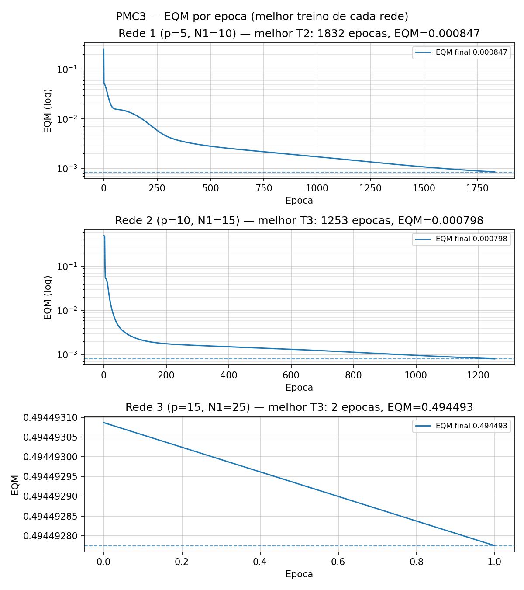
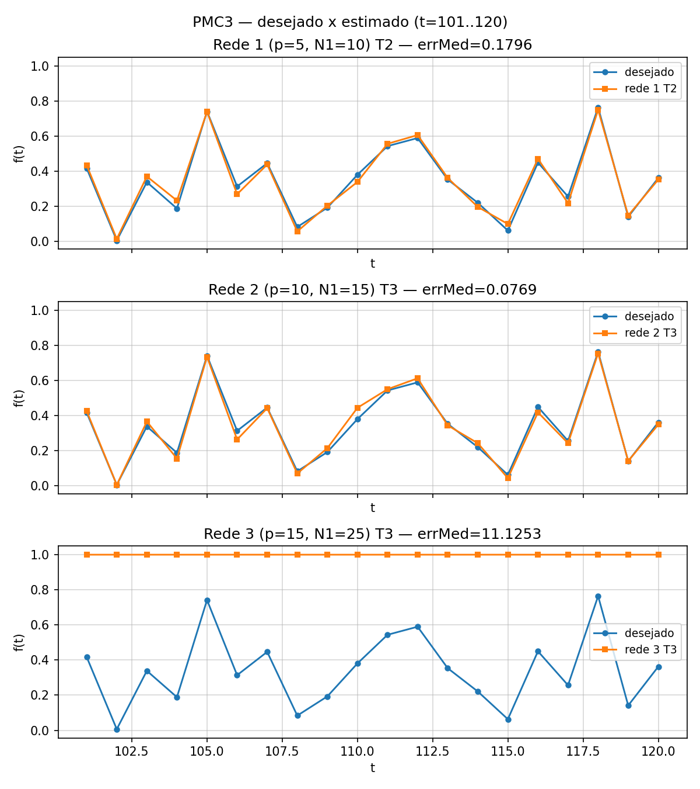

# PMC3 — Respostas (previsão de série temporal com TDNN)

## 1. O que a rede faz (conceito direto)
TDNN = usa o passado como entrada (janela deslizante). Com `p` lags:
entrada `[f(t−p) … f(t−1)]`, alvo `f(t)`. A rede aprende "dado o formato dos
últimos p pontos, qual o próximo". Saída única com sigmoid, compatível com a
série (valores em ~[0, 0.8], sem normalização extra).

Padrões de treino (série t=1..100): p=5 → t=6..100 (95 padrões);
p=10 → t=11..100 (90); p=15 → t=16..100 (85).
Teste (item 3): previsão um passo à frente em t=101..120 com lags reais
(no início a janela usa a cauda do treino — as séries foram concatenadas).

## 2. Configuração (item 1)
Backprop online com momentum em todos os 9 treinos. `pmc.py` reutilizado sem
alteração (só numpy). Pesos iniciais `U[0,1]`, um seed por treino (T1=42, T2=43,
T3=44 — diferentes entre si, como exige o enunciado).

| Rede | p | N1 | Padrões treino | eta | alfa | eps (parada) |
|------|---|----|----------------|-----|------|--------------|
| 1 | 5 | 10 | 95 | 0.1 | 0.8 | \|dEQM\|<0.5e-6, max 5000 ép |
| 2 | 10 | 15 | 90 | 0.1 | 0.8 | idem |
| 3 | 15 | 25 | 85 | 0.1 | 0.8 | idem |

## 3. Tabela dos 9 treinos (item 2)
| Treino | Rede 1 (EQM / épocas) | Rede 2 (EQM / épocas) | Rede 3 (EQM / épocas) |
|--------|----------------------|----------------------|----------------------|
| T1 | 0.001093 / 1832 (8.3 s) | 0.000820 / 1497 (6.7 s) | 0.494512 / 2 (0.0 s) |
| T2 | 0.000847 / 1832 (8.4 s) | 0.000888 / 1510 (6.7 s) | 0.494509 / 2 (0.0 s) |
| T3 | 0.000934 / 2059 (9.5 s) | 0.000798 / 1253 (5.7 s) | 0.494493 / 2 (0.0 s) |

Detalhe completo em `pmc3_tabela_treinos.csv`. O caso da Rede 3 é explicado no item 6.

## 4. Validação t=101..120 (item 3)
Erro relativo por padrão: `|d − y| / |d|` (fórmula literal). Média + variância
populacional (`1/N`) sobre os 20 padrões. Todas as 9 previsões em `pmc3_previsoes.csv`.

| | Rede 1 | Rede 2 | Rede 3 |
|---|---|---|---|
| T1 errMed / var | 0.1992 / 0.1942 | 0.0800 / 0.0054 | 11.1255 / 1183.80 |
| T2 errMed / var | 0.1796 / 0.1118 | 0.0872 / 0.0059 | 11.1255 / 1183.80 |
| T3 errMed / var | 0.2056 / 0.2588 | **0.0769 / 0.0059** | 11.1253 / 1183.77 |

Amostra a amostra (melhor de cada rede — Rede 1 T2, Rede 2 T3):

| t | desejado | R1-T2 (y / errRel) | R2-T3 (y / errRel) |
|---|----------|--------------------|--------------------|
| 101 | 0.4173 | 0.4348 / 0.042 | 0.4264 / 0.022 |
| 102 | 0.0062 | 0.0156 / 1.516 | 0.0062 / 0.002 |
| 103 | 0.3387 | 0.3710 / 0.095 | 0.3665 / 0.082 |
| 104 | 0.1886 | 0.2337 / 0.239 | 0.1560 / 0.173 |
| 105 | 0.7418 | 0.7396 / 0.003 | 0.7350 / 0.009 |
| 106 | 0.3138 | 0.2698 / 0.140 | 0.2643 / 0.158 |
| 107 | 0.4466 | 0.4390 / 0.017 | 0.4429 / 0.008 |
| 108 | 0.0835 | 0.0581 / 0.305 | 0.0711 / 0.149 |
| 109 | 0.1930 | 0.2046 / 0.060 | 0.2151 / 0.115 |
| 110 | 0.3807 | 0.3399 / 0.107 | 0.4450 / 0.169 |
| 111 | 0.5438 | 0.5571 / 0.024 | 0.5509 / 0.013 |
| 112 | 0.5897 | 0.6067 / 0.029 | 0.6130 / 0.040 |
| 113 | 0.3536 | 0.3627 / 0.026 | 0.3448 / 0.025 |
| 114 | 0.2210 | 0.1974 / 0.107 | 0.2434 / 0.101 |
| 115 | 0.0631 | 0.1002 / 0.588 | 0.0443 / 0.297 |
| 116 | 0.4499 | 0.4712 / 0.047 | 0.4190 / 0.069 |
| 117 | 0.2564 | 0.2188 / 0.147 | 0.2433 / 0.051 |
| 118 | 0.7642 | 0.7500 / 0.019 | 0.7550 / 0.012 |
| 119 | 0.1411 | 0.1488 / 0.055 | 0.1422 / 0.008 |
| 120 | 0.3626 | 0.3531 / 0.026 | 0.3494 / 0.036 |

Leitura didática: o erro relativo **explode em alvos próximos de zero** — t=102
(d=0.0062): a Rede 1 erra por 0.009 em valor absoluto, mas isso dá 152% de erro
relativo. É artefato da métrica, não da rede (a Rede 2 acertou 0.0062 quase exato
nesse ponto). Por isso a variância da Rede 1 é alta: 2–3 pontos de vale dominam
a média. A Rede 3 prevê ~1.0 em tudo (ver item 6), daí errMed ~11 e var ~1184.

## 5. EQM por época dos melhores (item 4)
Melhor = menor erro relativo médio no teste → R1-T2, R2-T3, R3-T3.
Mesma folha, não superpostos, grade + eixo log (painel da R3 em linear, pois a
curva travou — log achataria os ticks).

## 6. Desejado × estimado t=101..120 (item 5, mesmos melhores)

## 7. Melhor topologia (item 6)
**Rede 2 (p=10, N1=15), treino T3 (seed 44)**: menor erro relativo médio (0.0769),
variância baixa (0.0059), menor EQM de treino (0.000798) e menos épocas (1253).
Janela de 10 lags captura o ciclo da série melhor que 5 (curta demais, errMed
~0.18) sem os problemas da de 15. A curva acompanha picos e vales; o resíduo
maior está nos vales próximos de zero (t=115), pelo motivo da métrica acima.

## 8. Por que a Rede 3 não aprendeu (ponto didático central)
Não é bug: é **saturação da sigmoid na inicialização**. Com 15 entradas + bias
(fan-in 16) e pesos `U[0,1]` (média 0.5), a soma ponderada inicial é ~3–4, logo
`sigmoid ≈ 0.97–0.99` em todos os neurônios e a derivada `y(1−y) ≈ 0`. Gradiente
≈ 0 → pesos quase não mudam → `|dEQM| < eps` já na época 2 → parada com EQM
0.49 (rede prevê ~1.0 constante). Lição: inicialização precisa escalar com o
fan-in (é para isso que existem Xavier/He); `U[0,1]` puro quebra em redes largas.
Mantido o resultado honesto conforme o enunciado — e é exatamente por isso que a
Rede 3 é descartada no item 6.

## 9. Variantes do backprop (item 7)
- **RProp (Resilient Propagation):** ignora a magnitude do gradiente e usa só o
  **sinal**. Cada peso tem seu próprio passo: aumenta (×~1.2) se o sinal se mantém,
  diminui (×~0.5) se oscila. Vantagens: imune a saturação/platôs da sigmoid
  (o problema da Rede 3 acima), sem ajuste fino de `eta`, pouca memória, ótimo em
  batch. Limitação: pensado para batch, não online.
- **Levenberg-Marquardt (LM):** mistura gradiente-descendente com Gauss-Newton
  (`Δw = −(JᵀJ + μI)⁻¹Jᵀe`, com Jacobiana J). Converge em dezenas de épocas onde
  o backprop leva milhares. Vantagens: velocidade e precisão em redes
  pequenas/médias com erro quadrático. Limitações: precisa da Jacobiana
  (memória O(padrões × pesos) e inversão O(W³)) — inviável nas redes grandes de
  hoje; pode prender em mínimos locais; sensível ao `μ`.
- Regra prática: backprop+momentum (este trabalho) é simples e geral; RProp
  quando o gradiente satura; LM para regressão pequena com poucos pesos e pressa.
