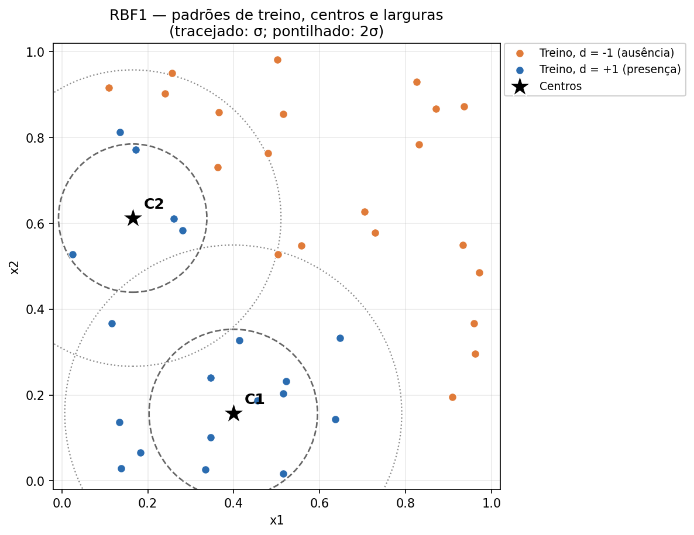
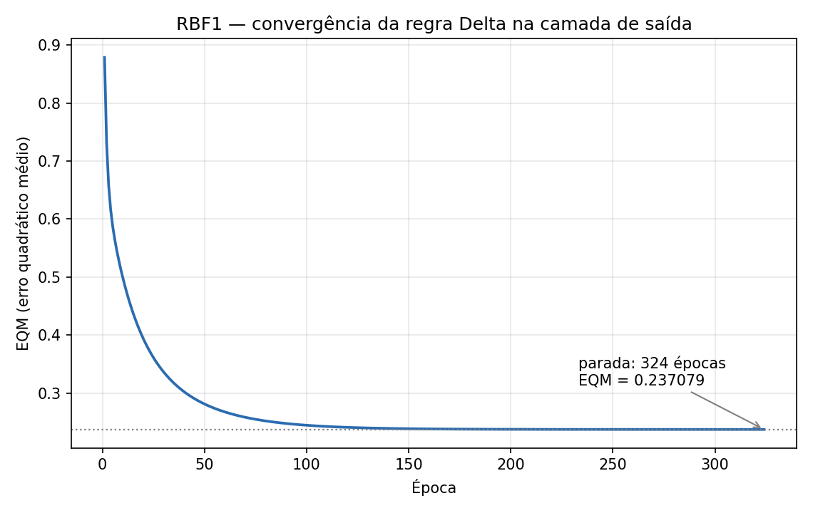
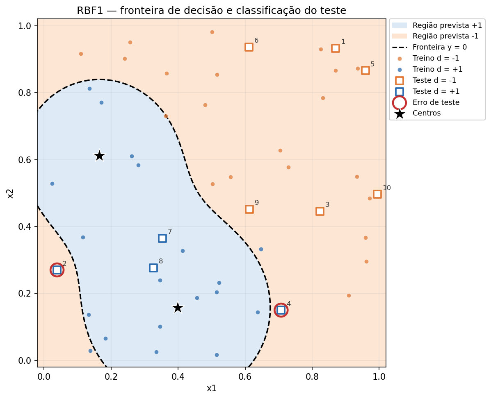

# RBF1 — Classificação de radiação (2 → 2 → 1)

> **Resumo das respostas**
>
> | Item | Resposta |
> |---|---|
> | **1. Centros e variâncias** | Cluster 1: 13 padrões, centro `(0.398969, 0.157131)`, `σ² = 0.038460`. Cluster 2: 6 padrões, centro `(0.164833, 0.612117)`, `σ² = 0.029806`. |
> | **2. Pesos da saída** | `W21,0 = 1.002544`, `W21,1 = 2.697521`, `W21,2 = 2.377596` (convenção `x0 = -1`; 324 épocas; EQM final `0.237079`). |
> | **3. Pós-processamento** | `y_pós = +1` se `y ≥ 0`; `y_pós = -1` caso contrário (função sinal, só no teste). |
> | **4. Taxa de acerto** | **80,00% (8/10)**. Erros nas amostras 2 e 4 (ambas `d = +1`): TP=2, FN=2, FP=0, TN=6. |
> | **5. Estratégias** | Mais centros, melhor posicionamento dos centros, ajuste da largura `σ`, mais dados representativos, validação e, se o custo justificar, limiar sensível a falsos negativos. Detalhes na seção 4. |

Código: `rbf.py` (núcleo) e `train_rbf1.py` (pipeline). Dados: `data/treinamento.csv` (40 padrões) e `data/teste.csv` (10 padrões). Todos os números deste documento são reproduzidos por `python3 train_rbf1.py`.

---

## 1. Criação da rede

### 1.1 A ideia central de uma RBF

Uma **rede de funções de base radial** (RBF, *Radial Basis Function*) organiza o aprendizado em três camadas:

1. **Entrada:** recebe o vetor `x = (x1, x2)`.
2. **Escondida:** cada neurônio representa uma **região** do espaço de entrada por meio de uma função que é máxima no centro e decai com a distância. Aqui usamos a gaussiana:
   ```
   φ_j(x) = exp( -||x - c_j||² / (2 σ_j²) )
   ```
   em que `c_j` é o **centro** (um ponto no espaço de entrada) e `σ_j²` é a **variância** (controla a largura).
3. **Saída:** combina linearmente as ativações:
   ```
   y(x) = -W21,0 + W21,1 φ_1(x) + W21,2 φ_2(x)
   ```

A intuição é simples: cada gaussiana é um “holofote” local. Ela vale aproximadamente 1 perto do seu centro e aproximadamente 0 longe dele. A saída aprende **quanto** cada holofote contribui e qual é o **limiar** para decidir entre as classes.

**Diferença em relação ao MLP:** no MLP, os neurônios escondidos usam sigmoide de uma soma ponderada e todos os pesos são treinados por retropropagação (problema não convexo, mais lento). Na RBF, a camada escondida é definida primeiro por **agrupamento não supervisionado** (k-means) e depois só a camada de saída é treinada (problema linear, convexo). Isso torna o treinamento mais rápido e os centros interpretáveis, mas o desempenho fica muito dependente da **posição dos centros** e da **largura** escolhida.

### 1.2 Arquitetura usada no exercício

```
x1 ─┐
    ├──► φ_1 (gaussiana, centro c1, variância σ1²) ─┐
x2 ─┘                                              ├──► y = -W21,0 + W21,1 φ1 + W21,2 φ2 ──► sinal ──► y_pós
    ├──► φ_2 (gaussiana, centro c2, variância σ2²) ─┘
```

- **2 entradas** (`x1`, `x2`).
- **2 neurônios escondidos**, um para cada cluster de padrões com radiação (item 1).
- **1 saída linear** com bias. O PDF não desenha a linha do bias, mas a tabela de pesos pede `W21,0`; portanto ele existe e é o **threshold** do neurônio de saída.
- **Convenção do bias:** `x0 = -1`, a mesma usada no Adaline do curso. Assim, `W21,0` é o threshold e a saída é `y = -W21,0 + W21,1 φ1 + W21,2 φ2`. Se o material usar `x0 = +1`, o mesmo modelo é escrito `y = W21,0 + ...` com `W21,0 = -1.002544`; os outros dois pesos não mudam.
- **Pós-processamento:** `y_pós = +1` se `y ≥ 0`, senão `-1` (função sinal do item 3).

### 1.3 O papel de cada componente (e por que ele importa)

- **Centro `c_j`:** indica *onde* está uma sub-região da classe “presença”. É obtido pelo k-means, sem usar o rótulo `d`.
- **Variância `σ_j²`:** indica *até onde* a gaussiana influence. Se for pequena, a rede cria “buracos” e deixa de reconhecer padrões positivos afastados; se for grande, as gaussianas se sobrepõem demais e a fronteira fica borrada, podendo gerar falsos positivos.
- **Pesos `W21,1` e `W21,2`:** dizem *quanto* cada gaussiana contribui para a saída positiva. Ambos são positivos, então as duas “votam” a favor da presença.
- **Threshold `W21,0`:** define o **fundo negativo**. Para um padrão negativo longe dos dois centros, `φ1 ≈ φ2 ≈ 0`, logo `y ≈ -W21,0 ≈ -1`. Sem o bias, `y ≈ 0`, e a função sinal classificaria esse padrão como `+1` (já que `0 ≥ 0`). O bias é o que faz a rede “começar” em `-1` e só subir para `+1` quando as gaussianas ativam o suficiente. Essa é a razão pela qual `W21,0` é positivo na convenção `x0 = -1`.
- **Saída linear:** os alvos são `±1` e a regra delta minimiza o erro quadrático. Não usamos sigmoide na saída porque ela limitaria a resposta a `(0,1)` e complicaria a leitura dos alvos `-1`; a saída linear com sinal é a escolha padrão para classificação bipolar em RBF.

### 1.4 Dados e pré-processamento

| Conjunto | Padrões | Positivos (`d=+1`) | Negativos (`d=-1`) | Faixa de `x1,x2` |
|---|---:|---:|---:|---|
| Treinamento (`treinamento.csv`) | 40 | 19 | 21 | `[0, 1]` |
| Teste (`teste.csv`) | 10 | 4 | 6 | `[0, 1]` |

- O enunciado menciona “50 situações conhecidas”: são **40 de treino + 10 de teste**.
- Não há valores ausentes nem duplicados.
- As entradas já estão normalizadas em `[0,1]`. Isso é importante porque a RBF usa **distância euclidiana**: se `x1` variasse de 0 a 1000 e `x2` de 0 a 1, a distância seria dominada por `x1`. Aqui as duas escalas são comparáveis, então não é necessário reescalar. Em um problema com escalas diferentes, o passo obrigatório seria padronizar (`z-score`) ou normalizar antes do k-means.

### 1.5 Configuração e hiperparâmetros

| Etapa | Escolha | Por quê |
|---|---|---|
| k-means | `k = 2`; só padrões com `d = +1`; seed 42; `n_init = 10`; máx. 300 iterações; tolerância `1e-10` | O item 1 pede 2 clusters e apenas os padrões com radiação. `n_init = 10` faz 10 reinícios e escolhe o de menor inércia, protegendo contra mínimos locais do k-means. |
| Variância | `σ_j² = (1/n_j) Σ ||x_i - c_j||²` (populacional) | É a variância descritiva do cluster em torno do centro. Usamos `÷ n_j` (populacional), consistente com `np.var` dos exercícios anteriores. |
| Gaussiana | `exp(-||x-c||² / (2σ²))` | Forma padrão da densidade gaussiana; `σ²` é a variância. O fator 2 vem da definição da gaussiana. |
| Saída | linear, com `x0 = -1` | Alvos `±1`; a regra delta minimiza o erro quadrático; o bias é o threshold. |
| Regra Delta | online (padrão por padrão), `η = 0.01`, `ε = 1e-7`, máx. 200.000 épocas; pesos iniciais `U[0,1]`, seed 42 | Convenção do Adaline do curso. A atualização online usa cada padrão imediatamente; o critério de parada é `|EQM(época) - EQM(época-1)| < 1e-7`. |
| Pós-processamento | `y_pós = +1` se `y ≥ 0`, senão `-1` | Função sinal do item 3, aplicada **apenas** no conjunto de teste. |

**Por que inicializar os pesos da saída com valores aleatórios?** O enunciado não especifica a inicialização para o RBF1. Usamos `U[0,1]` com seed fixa para ser reprodutível e para mostrar que, como a saída é linear, o problema é convexo: inicializações diferentes percorrem caminhos diferentes, mas chegam praticamente ao mesmo ponto. Na seção 2.2 mostramos uma verificação com várias seeds.

---

## 2. Treino

O treinamento tem duas fases independentes: primeiro a **camada escondida** (não supervisionada), depois a **camada de saída** (supervisionada). Essa separação é a marca da RBF.

### 2.1 Camada escondida — k-means (Item 1)

#### Passo a passo do algoritmo

1. **Filtrar os padrões positivos.** O item 1 pede explicitamente para considerar apenas os padrões com presença de radiação (`d = +1`). Restam **19 padrões**.
2. **Inicializar `k = 2` centros.** Usamos a inicialização de Forgy: escolhemos 2 padrões positivos distintos ao acaso (RNG com seed 42). Com `n_init = 10`, repetimos todo o processo 10 vezes com seeds diferentes e ficamos com o resultado de menor inércia.
3. **Atribuir cada padrão ao centro mais próximo** pela distância euclidiana (equivale a comparar distâncias ao quadrado).
4. **Recalcular cada centro** como a média dos padrões atribuídos a ele.
5. **Repetir** os passos 3–4 até o maior deslocamento dos centros ficar abaixo de `1e-10` (ou até 300 iterações).
6. **Calcular a variância de cada cluster:**
   ```
   σ_j² = (1/n_j) * Σ_{x_i ∈ C_j} ||x_i - c_j||²
   ```
   Ela é a média das distâncias quadráticas dos padrões do cluster ao seu centro. O desvio padrão `σ_j = √σ_j²` é a largura em unidades de `x`.

#### Por que k-means?

O k-means minimiza a **inércia** (soma das distâncias quadráticas intra-cluster):
```
J = Σ_{j=1}^{k} Σ_{x_i ∈ C_j} ||x_i - c_j||²
```
Ou seja, ele procura centros que representem bem os dados, sem usar os rótulos. Em uma RBF, cada centro vira o pico de uma gaussiana; faz sentido escolher centros que “cubram” as regiões onde os padrões positivos se concentram. É o método clássico e didático para a camada escondida.

#### Por que só os padrões positivos? (e qual é o preço)

O enunciado pede isso. A interpretação é: a camada escondida vai modelar a **classe de interesse** (presença de radiação) com duas sub-regiões; a ausência será representada pelas ativações baixas (as gaussianas “não disparam”) e pelo bias negativo na saída.

O preço é que o k-means **não vê os padrões negativos**: ele não sabe onde eles estão e não posiciona centros para “expulsá-los”. A fronteira final depende só das duas gaussianas positivas e do threshold. Se a classe positiva tiver um vazio (como entre os dois clusters), esse vazio vira uma região negativa; se um padrão positivo de teste cair nele, a rede erra. Os erros das amostras 2 e 4 são exatamente desse tipo (seção 3.3).

#### Resultado do Item 1

| Cluster | Padrões | Centro `(x1, x2)` | Variância `σ²` | Desvio `σ` | Inércia parcial `n·σ²` |
|---|---:|---|---:|---:|---:|
| **1** | 13 | `(0.398969, 0.157131)` | **0.038460** | 0.196112 | 0.499978 |
| **2** | 6 | `(0.164833, 0.612117)` | **0.029806** | 0.172643 | 0.178833 |

- **Inércia total:** `0.678811` (soma das duas parcelas).
- **Iterações do melhor reinício:** 2 (os centros iniciais já estavam próximos da solução).
- **Estabilidade:** os 10 reinícios produziram a **mesma inércia** e a mesma partição (a ordem dos clusters é apenas uma convenção). Isso é um bom sinal: o k-means não está preso a um mínimo local ruim neste conjunto.
- **Ordem dos clusters:** adotamos “Cluster 1 = maior” (13 padrões) e “Cluster 2 = menor” (6 padrões), para que a tabela seja determinística. A ordem não altera a saída da rede; apenas troca `W21,1` por `W21,2`.

**Leitura geométrica:** o Cluster 1 ocupa a região de `x1` mais alto e `x2` mais baixo (13 padrões, centro em `(0.399, 0.157)`); o Cluster 2 ocupa a região de `x2` mais alto (6 padrões, centro em `(0.165, 0.612)`). As larguras são parecidas (`σ ≈ 0.196` e `0.173`). Os círculos da figura abaixo mostram `σ` (tracejado) e `2σ` (pontilhado): a maior parte dos padrões de cada cluster fica dentro de ~2σ, e os círculos se sobrepõem no meio — por isso a região positiva final é uma “mancha” contínua, e não duas bolhas separadas.



Os padrões de cada cluster estão em `rbf1_clusters.csv`; os centros e variâncias em `rbf1_centros.csv`.

### 2.2 Camada de saída — regra Delta (Item 2)

#### O que a camada de saída vê

Depois do k-means, os centros e as variâncias ficam **fixos**. Para cada um dos **40 padrões de treino** (positivos e negativos), calculamos as ativações:
```
φ_1(x_i) = exp( -||x_i - c_1||² / (2σ_1²) )
φ_2(x_i) = exp( -||x_i - c_2||² / (2σ_2²) )
```
e montamos o vetor de entrada do neurônio de saída:
```
h_i = [ -1, φ_1(x_i), φ_2(x_i) ]
```
A primeira posição é o bias `x0 = -1`. A saída é:
```
y_i = w · h_i = -W21,0 + W21,1 φ_1(x_i) + W21,2 φ_2(x_i)
```

**Por que usar todos os 40 padrões e não só os positivos?** Porque a camada de saída precisa aprender a **separar as duas classes**. O k-means só viu os positivos para definir os centros; a regra delta precisa ver também os negativos para aprender o threshold que os rejeita. Se treinássemos a saída só com positivos, o bias seria puxado para `+1` e a rede não teria motivo para dizer “não” a um padrão negativo.

#### A regra Delta, passo a passo

Para cada padrão `i`, na ordem do arquivo:
```
y_i = w · h_i
e_i = d_i - y_i          (erro linear)
w   ← w + η e_i h_i      (atualização online)
```
Em componentes:
```
W21,0 ← W21,0 - η e_i          (porque h_0 = -1)
W21,1 ← W21,1 + η e_i φ_1(x_i)
W21,2 ← W21,2 + η e_i φ_2(x_i)
```
O EQM da época é calculado depois de passar por todos os padrões:
```
EQM = (1/40) Σ_i (d_i - y_i)²
```
e o treinamento para quando `|EQM(época) - EQM(época-1)| < 1e-7` (ou 200.000 épocas).

**De onde vem a regra?** Para um padrão, o erro quadrático é `E = ½(d - y)²`. A derivada em relação a um peso `w_j` é `∂E/∂w_j = -(d-y) h_j`. O gradiente descendente faz `w_j ← w_j - η ∂E/∂w_j = w_j + η(d-y)h_j`, que é exatamente a regra acima. Como a saída é linear nos pesos, `E` é uma função quadrática convexa; não há mínimos locais (ao contrário do MLP). A regra delta online com `η` constante não fica exatamente no mínimo: ela oscila em um **ciclo-limite** em torno dele, com amplitude proporcional a `η`. Por isso o EQM final é ligeiramente maior que o mínimo de mínimos quadrados (ver o resultado do Item 2, adiante).

#### Exemplo de uma atualização (primeiro padrão)

Vamos usar o primeiro padrão do arquivo, `x = (0.2563, 0.9503)`, `d = -1`, e os pesos iniciais sorteados com seed 42:

```
w_inicial = [0.773956, 0.438878, 0.858598]
h = [-1, φ1, φ2] = [-1, 0.000215, 0.127592]
y = 0.773956*(-1) + 0.438878*0.000215 + 0.858598*0.127592 = -0.664311
e = d - y = -1 - (-0.664311) = -0.335689
```

Atualização:
```
W21,0 ← 0.773956 - 0.01*(-0.335689) = 0.777313
W21,1 ← 0.438878 + 0.01*(-0.335689)*0.000215 ≈ 0.438878
W21,2 ← 0.858598 + 0.01*(-0.335689)*0.127592 ≈ 0.858170
```

**Leitura didática:** o padrão é negativo (`d = -1`), mas a saída inicial já é negativa (`y = -0.664`); mesmo assim a regra delta continua ajustando, porque ela minimiza o **erro quadrático** em relação a `-1`, não apenas acerta o sinal. O erro é negativo, então `W21,0` **aumenta** (o que torna `y = -W21,0 + ...` mais negativo) e os pesos das gaussianas quase não mudam, porque `φ1` e `φ2` são pequenos. Em outras palavras: o bias aprende o “fundo negativo”, e as gaussianas aprendem as regiões positivas.

#### Resultado do Item 2

| Peso | Valor inicial | Valor final |
|---|---:|---:|
| **W21,0** | 0.773956 | **1.002544** |
| **W21,1** | 0.438878 | **2.697521** |
| **W21,2** | 0.858598 | **2.377596** |

- **Épocas:** 324.
- **EQM final:** `0.23707862`.
- **Referência de mínimos quadrados:** `W_LS = [1.001227, 2.705124, 2.384426]`, `EQM_LS = 0.23421693`.
- **Diferença:** os pesos do delta estão a menos de `0.008` dos pesos ótimos e o EQM está ~1,2% acima do mínimo. Essa diferença é esperada no delta online com `η` constante (ciclo-limite); com `η` menor, ou com a versão em lote/forma fechada, o resultado se aproxima de `W_LS`. O importante é que o treinamento **convergiu** para perto do ótimo linear.

**Estabilidade com a inicialização:** repetindo o treino com seeds `10, 20, 30, 40, 42, 50`, os pesos finais diferem no máximo em ~`7×10⁻⁵` e as épocas ficam entre 320 e 342. Isso confirma a convexidade: a inicialização muda o **caminho** (e o número de épocas), não o **ponto de chegada** (a menos do ciclo-limite).

**Interpretação dos pesos:**
- `W21,0 = 1.002544` é o threshold. Para um padrão longe dos dois centros, `y ≈ -1.0025`, ou seja, a rede responde “ausência” com convicção.
- `W21,1 = 2.697521` e `W21,2 = 2.377596` são as “alturas” das duas gaussianas. Para uma gaussiana ativar sozinha a saída positiva, ela precisa de `φ ≥ W21,0 / W21,j`: `0.3717` para o Cluster 1 e `0.4217` para o Cluster 2. Convertendo em distância, isso corresponde a ~`1.41σ` e ~`1.31σ` do centro, respectivamente. Essa conta explica por que a região positiva não é infinita: ela termina onde a gaussiana cai abaixo desse limiar.

A curva de EQM por época mostra a queda rápida nas primeiras ~50 épocas e a cauda lenta até o critério de parada:



O EQM não vai a zero porque o modelo é limitado: com apenas duas gaussianas isotrópicas, não é possível acertar todos os 40 padrões. O patamar em ~0.237 está no limite do que essa arquitetura consegue representar (o mínimo de mínimos quadrados é 0.234). Isso **não é falha de treinamento**; é limite de representação. Os três erros de treino da seção 2.3 mostram onde o modelo não consegue separar.

### 2.3 Diagnóstico do treinamento (material para o item 5)

No próprio conjunto de treino, a rede acerta **37/40 = 92,5%**. Os três erros são:

| Amostra | `x1` | `x2` | `d` | `φ1` | `φ2` | `y` | Leitura |
|---:|---:|---:|---:|---:|---:|---:|---|
| 28 | 0.1373 | 0.0292 | +1 | 0.331897 | 0.003303 | **-0.099391** | Positivo na borda inferior do Cluster 1; a gaussiana não chega forte o suficiente. |
| 30 | 0.3626 | 0.7302 | -1 | 0.013750 | 0.410645 | **+0.010897** | Negativo na cauda superior do Cluster 2; `y` fica só um pouco acima de 0. |
| 31 | 0.6474 | 0.3324 | +1 | 0.300672 | 0.005413 | **-0.178606** | Positivo na borda direita do Cluster 1; a fronteira corta o padrão. |

Todos os três estão **próximos da fronteira** (`|y|` pequeno). Não são erros aleatórios: são consequência da geometria das duas gaussianas. Isso antecipa a discussão do item 5 — o caminho para melhorar não é “treinar mais”, e sim mudar a representação (centros/largura) ou os dados.

---

## 3. Teste

### 3.1 Pós-processamento (Item 3)

A rede devolve números reais (`y`), não rótulos. Para classificar, aplicamos a função sinal **apenas no teste**:
```
y_pós = +1, se y ≥ 0
y_pós = -1, se y < 0
```
Em código:
```python
def pos_processar(y):
    return np.where(y >= 0, 1, -1)
```

**Por que não aplicar o sinal durante o treinamento?** Porque a regra delta precisa do erro **linear** `e = d - y` para saber a distância até o alvo e ajustar os pesos proporcionalmente. Se aplicássemos o sinal antes, o erro seria apenas `0` ou `±2` e perderíamos a informação de “quão longe” a saída está; a rede não aprenderia a magnitude. O sinal é uma **decisão**, não uma ativação treinável. Além disso, o item 3 pede explicitamente que a função seja usada apenas no pós-processamento do conjunto de teste.

### 3.2 Resultados no conjunto de teste (Item 4)

A tabela abaixo traz as ativações (`φ1`, `φ2`) e a saída real (`y`) além do que o enunciado pede (`d`, `y`, `y_pós`). As ativações ajudam a entender **por que** cada padrão foi classificado como foi.

| Amostra | `x1` | `x2` | `d` | `φ1` | `φ2` | `y` | `y_pós` | Situação |
|---:|---:|---:|---:|---:|---:|---:|---:|---|
| 1 | 0.8705 | 0.9329 | -1 | 0.000022 | 0.000042 | -1.002384 | -1 | acerto |
| 2 | 0.0388 | 0.2703 | +1 | 0.156772 | 0.107907 | **-0.323088** | **-1** | **erro** |
| 3 | 0.8236 | 0.4458 | -1 | 0.032468 | 0.000433 | -0.913929 | -1 | acerto |
| 4 | 0.7075 | 0.1502 | +1 | 0.289916 | 0.000200 | **-0.220015** | **-1** | **erro** |
| 5 | 0.9587 | 0.8663 | -1 | 0.000025 | 0.000009 | -1.002457 | -1 | acerto |
| 6 | 0.6115 | 0.9365 | -1 | 0.000207 | 0.006024 | -0.987665 | -1 | acerto |
| 7 | 0.3534 | 0.3646 | +1 | 0.556223 | 0.197064 | 0.966417 | +1 | acerto |
| 8 | 0.3268 | 0.2766 | +1 | 0.776260 | 0.097441 | 1.323109 | +1 | acerto |
| 9 | 0.6129 | 0.4518 | -1 | 0.178382 | 0.022392 | -0.468115 | -1 | acerto |
| 10 | 0.9948 | 0.4962 | -1 | 0.002220 | 0.000008 | -0.996536 | -1 | acerto |

**Taxa de acerto: 8/10 = 80,00%.**

**Matriz de confusão:**

| | Previsto `+1` | Previsto `-1` |
|---|---:|---:|
| **Real `+1`** (presença) | TP = 2 | **FN = 2** |
| **Real `-1`** (ausência) | FP = 0 | TN = 6 |

- **Acurácia:** `(TP + TN) / 10 = (2 + 6) / 10 = 80%`.
- **Revocação (recall) da classe positiva:** `TP / (TP + FN) = 2/4 = 50%`. A rede deixa passar metade dos padrões positivos.
- **Especificidade (classe negativa):** `TN / (TN + FP) = 6/6 = 100%`. Nenhum falso alarme.
- **Precisão da classe positiva:** `TP / (TP + FP) = 2/2 = 100%`. Quando a rede diz “presença”, ela está certa; o problema é que ela diz “presença” poucas vezes.

No contexto de radiação, **falso negativo** (FN) é o erro mais grave: significa dizer que não há radiação quando há. A rede atual tem 0 falsos positivos, mas 2 falsos negativos. Isso será central no item 5.

### 3.3 Por que as amostras 2 e 4 falham

As duas são positivas (`d = +1`) e recebem `y < 0`. Vamos decompor a saída:

**Amostra 2** — `x = (0.0388, 0.2703)`:
```
y = -1.002544 + 2.697521*0.156772 + 2.377596*0.107907
  = -1.002544 + 0.422897 + 0.256559
  = -0.323088
```
- Distâncias aos centros: `0.3775` do Cluster 1 e `0.3643` do Cluster 2.
- As duas ativações são pequenas (`0.157` e `0.108`); a soma ponderada (`0.679`) não chega ao threshold (`1.003`).
- O vizinho positivo mais próximo no treino é a **amostra 3** `(0.1157, 0.3676)`, a `0.124` de distância. Mas a amostra 3 está na **borda** do Cluster 2: o centro está em `(0.165, 0.612)`, a `0.249` dela (~`1,44σ`). O k-means não colocou um centro nessa região porque ela tem poucos pontos; a gaussiana do Cluster 2, com `σ = 0.173`, chega ali com `φ ≈ 0.108`.
- **Em uma frase:** a amostra 2 cai em um **vazio entre os clusters**; a largura atual não é suficiente para cobrir esse vazio.

**Amostra 4** — `x = (0.7075, 0.1502)`:
```
y = -1.002544 + 2.697521*0.289916 + 2.377596*0.000200
  = -1.002544 + 0.782054 + 0.000474
  = -0.220015
```
- Distância ao Cluster 1: `0.3086` (~`1.57σ`); ao Cluster 2: `0.7126`.
- `φ1 = 0.2899` e `φ2 ≈ 0.0002`; a contribuição do Cluster 1 (`0.782`) ainda fica abaixo do threshold (`1.003`).
- O vizinho positivo mais próximo é a **amostra 12** `(0.6371, 0.1439)`, a apenas `0.0707` de distância. A amostra 12 é classificada corretamente, mas com `y = +0.2866` (perto da fronteira). A amostra 4 está **do outro lado da fronteira**, alguns décimos de `x1` à direita.
- `x1 = 0.7075` é maior que o maior `x1` positivo do treino (`0.6474`), então há também uma **extrapolação leve**. Mas o vizinho próximo mostra que o problema principal é a **largura/posição da fronteira**, não a falta total de referência.
- **Em uma frase:** a amostra 4 está na **borda** da região positiva; a gaussiana do Cluster 1 decai antes de alcançá-la. Um centro extra perto da amostra 12, ou uma largura um pouco maior, resolveria.

A figura abaixo mostra as regiões previstas (`+1` em azul, `-1` em laranja), a fronteira `y = 0` (linha tracejada), os centros (estrelas) e os erros de teste circulados em vermelho:



**Leitura da figura:** a região azul é a união das duas gaussianas acima do threshold. As amostras 2 e 4 caem nas “baías” laranjas ao redor dessa região. As amostras negativas (quadrados laranja) estão todas longe, na região laranja, e são corretamente rejeitadas. Isso mostra que o modelo aprendeu bem o “fundo negativo”, mas a cobertura da classe positiva tem buracos.

### 3.4 Diagnóstico no treino × teste

| Conjunto | Acertos | Taxa | Erros |
|---|---:|---:|---|
| Treino | 37/40 | 92,5% | amostras 28, 30, 31 (todas na fronteira) |
| Teste | 8/10 | 80,0% | amostras 2 e 4 (falsos negativos) |

A diferença entre 92,5% e 80% é compatível com a limitação do modelo e com o tamanho pequeno do teste (10 padrões). Não há sinal de overfitting clássico (a diferença entre treino e teste é pequena e os erros de treino também estão na fronteira); o que há é **underfitting estrutural**: duas gaussianas isotrópicas não conseguem representar todos os detalhes da classe positiva. A seção 4 discute como mudar isso.

---

## 4. Respostas textuais

### 4.1 Item 5 — estratégias para tentar aumentar a taxa de acerto

**Primeiro, um diagnóstico importante:** o treinamento **convergiu** (EQM estável, pesos a menos de 0,008 do ótimo de mínimos quadrados, curvas suaves). Portanto, aumentar o número de épocas ou diminuir o `ε` não deve resolver. O limite é a **representação**: dois centros, duas larguras isotrópicas e um threshold. As estratégias abaixo atacam esse limite, em ordem de custo/benefício.

| # | Estratégia | Como fazer | Por que ajudaria neste caso | Risco |
|---|---|---|---|---|
| 1 | **Aumentar o número de neurônios escondidos (`N1`)** | Testar `k = 3, 4, 5...` no k-means dos positivos; escolher por validação cruzada. | Mais centros podem dividir os clusters alongados e colocar um centro perto da amostra 3 (ajudaria a amostra 2) ou da amostra 12 (ajudaria a amostra 4). Hoje, dois centros são grossos demais para a forma real da classe. | Com mais clusters, a variância de cada um diminui e as gaussianas ficam mais estreitas; isso pode criar novos buracos. É preciso reajustar `σ` junto. |
| 2 | **Melhorar o posicionamento dos centros** | Usar k-means em **todos** os 40 padrões (não só nos positivos), ou um esquema por classe (ex.: 1 cluster para negativos + 2–3 para positivos), ou k-means++/mais reinícios; ou seleção supervisionada de centros (escolher centros que mais reduzem o erro da saída). | O k-means atual só vê os positivos; ele não sabe onde estão os negativos e não otimiza a fronteira. Centros um pouco mais à esquerda/embaixo (para a amostra 3) e à direita (para a amostra 12) cobririam os dois erros. | Centros em regiões negativas podem “roubar” ativação dos positivos; validar. |
| 3 | **Ajustar a largura `σ`** | Multiplicar as variâncias por um fator `α` (ex.: 0.5, 1, 2, 3, 4) e escolher por validação; ou usar heurísticas como `σ_j =` distância média aos `k` vizinhos mais próximos, ou `σ_j =` distância ao centro mais próximo. | As amostras 2 e 4 têm `φ` de 0,11–0,29; com uma largura maior, `φ` sobe e a soma pode passar do threshold. A amostra 2 está a ~2,1σ do centro do Cluster 2; a 4, a ~1,6σ do Cluster 1. | Se alargar demais, padrões negativos próximos da fronteira (como a amostra 30 do treino, que já tem `y = +0,011`) viram falsos positivos. É um trade-off clássico de RBF. |
| 4 | **Mais dados, especialmente positivos nos vazios** | Coletar amostras positivas perto de `(0.04, 0.27)` e `(0.65, 0.15)` (e em outras regiões de borda); aumentar o conjunto de teste. | Com 19 positivos, o k-means e a variância são estimativas grosseiras. Amostras nesses vazios fariam o k-means colocar centros onde hoje não há, e a variância refletiria melhor a dispersão real. Um teste maior também reduz a incerteza do 80%. | Custo de coleta; em um problema real, pode não ser possível obter amostras nessas condições. |
| 5 | **Normalizar/padronizar as entradas** | Se as escalas forem diferentes, aplicar `z-score` ou normalização min-max antes do k-means. | Aqui `x1` e `x2` já estão em `[0,1]`, então esse não é o problema atual; mas é um passo de higiene obrigatório em RBF, porque a distância euclidiana é sensível à escala. | Nenhum, se feito corretamente; só cuidado para aplicar a mesma transformação no teste. |
| 6 | **Validação e seleção de modelo** | Separar um conjunto de validação (ou usar validação cruzada) para escolher `N1`, `σ`, inicialização e época; não escolher olhando o teste. | O 80% é uma estimativa de **10 amostras**; a incerteza é grande (intervalo de confiança de 95% aproximado: 49%–95%). Sem validação, qualquer ajuste pode ser overfitting ao teste. | Custo computacional; com 40 padrões, a validação cruzada deixa poucos dados por dobra. |
| 7 | **Limiar sensível ao custo** | Em vez de `y ≥ 0`, usar um limiar menor (ex.: `y ≥ -0,2`) para aumentar a revocação; escolher o ponto de operação por curva ROC/PR. | O exercício fixa `sign(0)`, mas na aplicação real um falso negativo (radiação não detectada) é muito pior que um falso positivo. Baixar o limiar pode capturar as amostras 2 e 4. | Aumenta os falsos positivos; é uma decisão de engenharia, não de treinamento. O item 3 pede `sign(0)`, então isso é uma observação fora da regra do exercício. |
| 8 | **Gaussianas anisotrópicas** | Usar uma matriz de covariância por cluster (gaussiana elíptica) em vez de uma única variância escalar. | Os clusters positivos são alongados (o Cluster 1 se espalha em `x1` e `x2`); uma gaussiana circular pode não cobrir bem as bordas. Uma elipse alinhada com a dispersão cobriria a amostra 4 sem alargar em todas as direções. | Mais parâmetros para estimar (com 6–13 pontos por cluster, a covariância é ruidosa); precisa de regularização. |
| 9 | **Regularização / ensemble** | Se aumentar `N1`, usar *weight decay* (ridge) na saída linear ou *early stopping*; ou combinar várias RBFs com centros/larguras diferentes (bagging). | A saída é linear, então a regularização ridge é barata e controla o overfitting quando `N1` cresce. Um ensemble reduz a variância da decisão. | Pode underfittar se a regularização for forte; ensemble custa mais tempo/inferência. |
| 10 | **Comparar com o MLP** | Usar os resultados do MLP já treinado pela equipe como referência; se o MLP tiver acurácia melhor, avaliar o custo/benefício. | O próprio enunciado do RBF2 motiva o contraste RBF × MLP. A RBF é mais rápida e interpretável; o MLP pode ser mais flexível. | O MLP é mais lento e não convexo; a comparação deve ser feita no mesmo conjunto de teste. |

**Ordem prática sugerida (se o objetivo for melhorar esta RBF):**

1. **Testar `N1 = 3` a `5`** com k-means nos positivos e **variar `σ`** (fator 1–3), escolhendo por validação cruzada. É a intervenção com maior chance de cobrir os dois erros.
2. Se não bastar, **mudar o posicionamento dos centros** (k-means em todos os padrões ou por classe) ou usar **gaussianas anisotrópicas**.
3. **Coletar mais positivos nos vazios** e aumentar o conjunto de teste; sem isso, qualquer ganho de 1–2 amostras pode ser sorte.
4. Para implantação, **priorizar revocação** (evitar falsos negativos) e escolher o limiar por ROC/PR, aceitando mais falsos positivos se o custo justificar.

### 4.2 Conclusão

- A RBF 2–2–1 foi treinada em duas fases: k-means nos 19 padrões positivos (2 centros, variâncias `0.038460` e `0.029806`) e regra delta nos 40 padrões (pesos `1.002544`, `2.697521`, `2.377596`, 324 épocas, EQM `0.237079`).
- No teste, acertou **8/10 = 80%**: 6/6 negativos e 2/4 positivos. Os dois erros são falsos negativos em regiões de **vazio/borda** da classe positiva (amostras 2 e 4).
- O treinamento **não falhou**: o EQM estabilizou e os pesos ficaram próximos da solução de mínimos quadrados. O limite é a **capacidade da representação** (dois centros, larguras isotrópicas, k-means só nos positivos). O item 5 trata exatamente de como relaxar esse limite.
- A leitura didática central: em RBF, **centro e largura são tão importantes quanto os pesos**. A camada de saída é convexa e fácil de treinar; o verdadeiro projeto está em **onde colocar as gaussianas e quão largas elas são**.

### 4.3 Convenções e observações

- **Gaussiana:** usamos `exp(-||x-c||²/(2σ²))`. Se o material do curso usar `exp(-||x-c||²/σ²)` (sem o fator 2), os valores numéricos dos pesos e do EQM mudam, mas o método e a interpretação são os mesmos.
- **Bias:** usamos `x0 = -1` (convenção do Adaline). Com `x0 = +1`, o mesmo modelo tem `W21,0 = -1.002544` e os demais pesos iguais. A escolha não altera as saídas `y` nem a acurácia; só muda a forma de escrever a equação.
- **Variância:** usamos a versão populacional (`÷ n_j`). Com a amostral (`÷ (n_j - 1)`), as variâncias sobem um pouco (`0.041665` e `0.035767`), os pesos mudam ligeiramente, mas a acurácia de teste continua **80%** — a conclusão não depende dessa escolha.
- **O “1” no neurônio de saída do PDF** é o rótulo do neurônio (como os “1” e “2” dos ocultos), não uma entrada de bias. O bias existe porque a tabela pede `W21,0`; nós o incluímos explicitamente.
- **Faixa da saída:** a saída linear não é limitada a `[-1,1]`; a amostra 8, por exemplo, dá `y = 1.323`. Isso é normal: o que importa para a classificação é o sinal. Os alvos `±1` são usados no erro quadrático, não como limite físico.
- **Tamanho do teste:** 10 padrões é pouco. O 80% deve ser lido como uma estimativa com bastante incerteza; para uma conclusão robusta, o ideal é um conjunto de teste maior ou validação cruzada.

### 4.4 Como reproduzir

```bash
python3 train_rbf1.py
```

O script:

1. lê `data/treinamento.csv` e `data/teste.csv`;
2. roda o k-means só nos positivos (seed 42, 10 reinícios);
3. calcula as gaussianas e treina a saída com a regra delta online (`η=0.01`, `ε=1e-7`, seed 42);
4. aplica a função sinal no teste e calcula a acurácia/matriz de confusão;
5. salva as tabelas e figuras em `docs/answers/rbf1/`.

Dependências: `numpy`, `pandas`, `matplotlib` (sem sklearn; o k-means e a regra delta são implementados em `rbf.py`).

### 4.5 Arquivos gerados

| Arquivo | Conteúdo |
|---|---|
| `rbf1_centros.csv` | Cluster, número de padrões, centro, variância, desvio padrão e inércia parcial. |
| `rbf1_pesos.csv` | Pesos iniciais e finais de `W21,0`, `W21,1`, `W21,2`. |
| `rbf1_treino_eqm.csv` | EQM por época (324 linhas). |
| `rbf1_clusters.csv` | Padrões positivos com o cluster atribuído. |
| `rbf1_teste.csv` | Tabela completa do teste: `x1`, `x2`, `d`, `φ1`, `φ2`, `y`, `y_pós`, acerto. |
| `rbf1_clusters.png` | Padrões de treino, centros e círculos de `σ` e `2σ`. |
| `rbf1_eqm.png` | Curva de EQM por época. |
| `rbf1_fronteira.png` | Fronteira de decisão, regiões previstas e erros de teste. |
