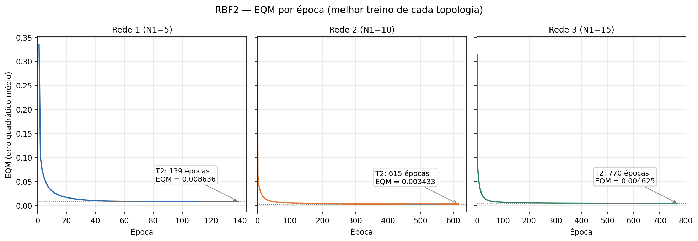
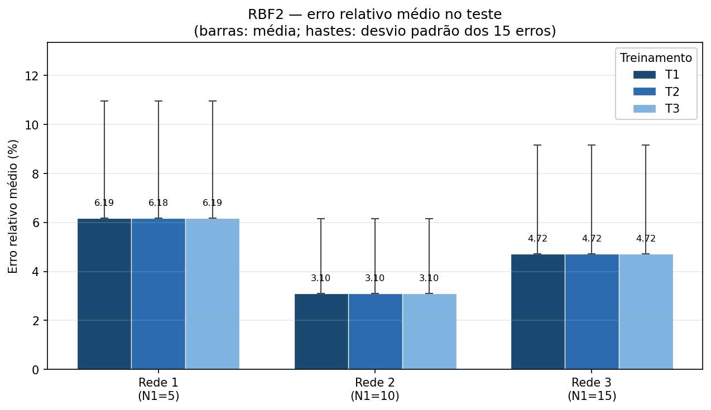
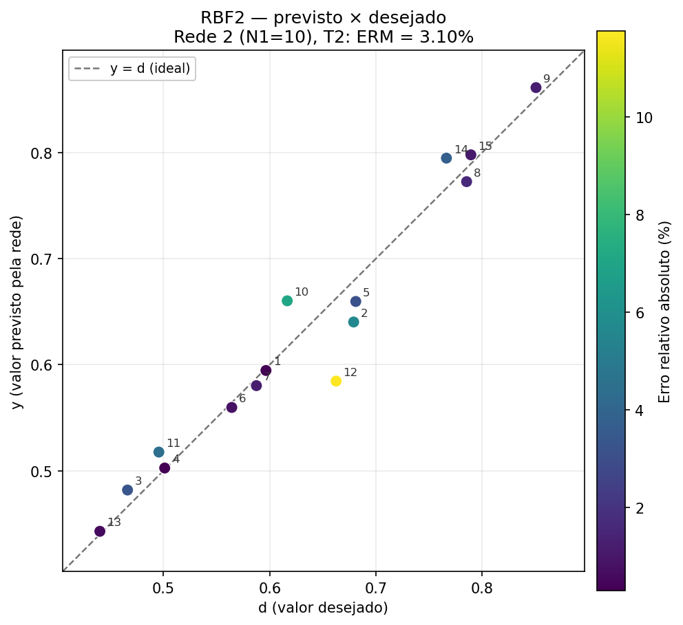

# RBF2 — Aproximação da quantidade de gasolina (3 → N1 → 1)

> **Resumo das respostas**
>
> | Item | Resposta |
> |---|---|
> | **1. Treinamentos** | 3 topologias (N1 = 5, 10 e 15) × 3 treinos (T1, T2, T3), com pesos iniciais `U[0,1]` e seeds 42, 43 e 44. `η = 0.01`, `ε = 1e-7`. |
> | **2. EQM e épocas** | Rede 1: EQM ≈ `0.008636` e 139–148 épocas. Rede 2: EQM ≈ `0.003433` e 615–656 épocas. Rede 3: EQM ≈ `0.004625` e 770–864 épocas. |
> | **3. Erro relativo e variância** | Rede 1: **6,18%** e **22,74 %²**. Rede 2: **3,10%** e **9,34 %²**. Rede 3: **4,72%** e **19,71 %²** (médias dos três treinos). |
> | **4. Gráficos** | Figura `rbf2_eqm.png`, com os três gráficos de EQM × época na mesma folha, um por topologia, usando o melhor treino de cada uma. |
> | **5. Recomendação** | **Rede 2 (N1 = 10), treino T2**: ERM `3,0958%`, variância `9,3391 %²`, DP `3,0560%`, EQM `0.003433` e 615 épocas. T1, T2 e T3 são praticamente equivalentes; T2 teve o menor ERM nominal. |

Código: `train_rbf2.py` (pipeline) e `rbf.py` (k-means, gaussianas e regra Delta). Dados: `data/treinamento2.csv` (150 padrões) e `data/teste2.csv` (15 padrões). Todos os resultados de treino e teste deste documento são reproduzidos por `python3 train_rbf2.py`; as distâncias e os vizinhos citados na seção 3.4 são calculados a partir desses mesmos CSVs.

---

## 1. Criação da rede

### 1.1 A ideia central de uma RBF para aproximação

O problema do RBF2 é diferente do RBF1. No RBF1, a rede precisava **separar duas classes** e a saída era pós-processada pela função sinal. Aqui, a rede precisa **aproximar uma função contínua**: dados `x1`, `x2` e `x3`, ela deve devolver um valor real `y` próximo da quantidade de gasolina desejada. Não há rótulos `±1` nem função sinal no final.

A RBF continua organizada em três camadas:

1. **Entrada:** recebe o vetor `x = (x1, x2, x3)`.
2. **Escondida:** cada neurônio representa uma região do espaço de entrada por uma gaussiana:
   ```
   φ_j(x) = exp( -||x - c_j||² / (2 σ_j²) )
   ```
   em que `c_j` é o centro e `σ_j²` é a variância do cluster `j`.
3. **Saída:** combina linearmente as ativações, com bias:
   ```
   y(x) = -W21,0 + W21,1 φ_1(x) + ... + W21,N1 φ_N1(x)
   ```

A intuição é a mesma do RBF1: cada gaussiana funciona como um “holofote” local, valendo aproximadamente 1 perto do seu centro e caindo para 0 longe dele. A diferença é que agora a saída não precisa apenas decidir “sim/não”; ela precisa **combinar os holofotes** para reproduzir o valor desejado. Por isso os pesos da saída podem ser positivos ou negativos: cada gaussiana pode empurrar a saída para cima ou para baixo.

**Diferença em relação ao RBF1:**

| Aspecto | RBF1 | RBF2 |
|---|---|---|
| Tarefa | Classificação binária | Aproximação funcional |
| Alvos | `±1` | Valores contínuos entre 0 e 1 |
| k-means | Só nos padrões com `d = +1` | Em todos os 150 padrões |
| Saída | Linear + função sinal | Linear, sem pós-processamento |
| Métrica | Taxa de acerto | Erro relativo médio e variância |
| Topologias | 2 neurônios escondidos | `N1 = 5, 10, 15` |

### 1.2 Arquitetura usada no exercício

```
x1 ─┐
    │
x2 ─┼──► φ_1 (c1, σ1²) ─┐
    │       ...           ├──► y = -W21,0 + Σ W21,j φ_j ──► y
x3 ─┘──► φ_N1 (cN1, σN1²) ┘
```

- **3 entradas** (`x1`, `x2`, `x3`).
- **N1 neurônios escondidos**, com `N1 ∈ {5, 10, 15}`.
- **1 saída linear** com bias `x0 = -1`.
- **Sem função sinal**: a saída é o próprio valor aproximado.

**Convenção do bias:** usamos `x0 = -1`, a mesma convenção do Adaline e do RBF1. Assim,
```
y = -W21,0 + W21,1 φ_1 + ... + W21,N1 φ_N1
```
e `W21,0` é o offset da saída. Se o material do curso usar `x0 = +1`, o mesmo modelo é escrito com `W21,0` de sinal trocado; as previsões não mudam.

### 1.3 O papel de cada componente

- **Centro `c_j`:** indica *onde* está uma região representativa do espaço de entrada. É obtido pelo k-means, sem usar o valor desejado `d`.
- **Variância `σ_j²`:** controla *até onde* a gaussiana influencia. Se for pequena, a rede cria regiões muito locais e pode deixar “buracos” entre elas; se for grande, as gaussianas se sobrepõem demais e a rede suaviza demais a função.
- **Pesos `W21,j`:** dizem *quanto* e *em que direção* cada gaussiana contribui para a saída. Podem ser positivos ou negativos.
- **Bias `W21,0`:** desloca o nível médio da saída. No melhor modelo (Rede 2, T2), `W21,0 = -0.453214`; portanto, longe de todos os centros, `y ≈ +0.4532`. No RBF1, o bias era positivo porque o “fundo” era a classe negativa; aqui o alvo é positivo e o offset ajustado também ficou positivo.
- **Saída linear:** os alvos são contínuos e a regra Delta minimiza o erro quadrático. Não usamos sigmoide na saída, pois ela limitaria a resposta e distorceria a escala dos valores desejados.

### 1.4 Dados e pré-processamento

| Conjunto | Padrões | Entradas | Faixa de `x1,x2,x3` | Faixa de `d` |
|---|---:|---|---|---|
| Treinamento (`treinamento2.csv`) | 150 | 3 | `[0, 1]` | `[0.0851, 0.9840]` |
| Teste (`teste2.csv`) | 15 | 3 | `[0.0396, 0.9108]` | `[0.4402, 0.8506]` |

- Não há valores ausentes nem duplicados.
- As entradas já estão normalizadas em `[0,1]`. Isso é importante porque a RBF usa **distância euclidiana**: se as variáveis tivessem escalas muito diferentes, a distância seria dominada pela maior. Aqui as três escalas são comparáveis, então não é necessário reescalar.
- Como todos os `d` são positivos e relativamente afastados de zero, o erro relativo `|d-y|/d` é bem definido e estável.

### 1.5 Configuração e hiperparâmetros

| Etapa | Escolha | Por quê |
|---|---|---|
| Topologias | `N1 = 5, 10, 15` | São as três redes pedidas no enunciado. |
| k-means | `k = N1`; todos os 150 padrões; seed 42; `n_init = 10`; máx. 300 iterações; tolerância `1e-10` | Não há classes: o objetivo é cobrir o domínio de entrada. Os 10 reinícios protegem contra mínimos locais. |
| Variância | `σ_j² = (1/n_j) Σ ‖x_i - c_j‖²` (populacional) | É a variância descritiva do cluster em torno do centro, consistente com o RBF1. |
| Gaussiana | `exp(-‖x-c‖² / (2σ²))` | Forma padrão da densidade gaussiana; o fator 2 vem da definição. |
| Saída | Linear, com `x0 = -1` | Alvos contínuos; a regra Delta minimiza o erro quadrático; o bias ajusta o nível médio. |
| Regra Delta | Online, padrão por padrão, na ordem do arquivo; `η = 0.01`; `ε = 1e-7`; máx. 200.000 épocas | Mesma convenção do RBF1 e dos exercícios anteriores. |
| Pesos iniciais | `U[0,1]`, seeds 42, 43 e 44 para T1, T2 e T3 | O enunciado pede valores entre 0 e 1 e geradores diferentes em cada treinamento. |
| Camada escondida | Fixa nos três treinos de cada topologia | O enunciado pede para variar a inicialização da **camada de saída**; fixar os centros isola esse efeito. |
| Pós-processamento | Nenhum | O problema é de aproximação; a saída já é o valor desejado. |

**Por que a camada escondida é fixa entre T1, T2 e T3?** O k-means define os centros e as larguras. Se ele fosse reexecutado em cada treino, as diferenças entre T1, T2 e T3 misturariam dois efeitos: a inicialização da saída e a partição dos dados. Fixando a camada escondida, os três treinos diferem apenas no que o enunciado pede — os pesos iniciais da saída — e a comparação fica limpa.

---

## 2. Treino

### 2.1 Camada escondida — k-means em todos os padrões (Item 1)

#### Passo a passo

1. **Usar todos os 150 padrões de treino**, pois não há classes.
2. **Inicializar `k = N1` centros** escolhendo `N1` padrões distintos ao acaso (inicialização de Forgy, seed 42).
3. **Atribuir cada padrão ao centro mais próximo** pela distância euclidiana.
4. **Recalcular cada centro** como a média dos padrões atribuídos a ele.
5. **Repetir** os passos 3–4 até o maior deslocamento dos centros ficar abaixo de `1e-10` (ou até 300 iterações).
6. **Calcular a variância de cada cluster:**
   ```
   σ_j² = (1/n_j) Σ_{x_i ∈ C_j} ||x_i - c_j||²
   ```
7. **Repetir todo o processo 10 vezes** com inicializações diferentes e escolher o resultado de menor inércia:
   ```
   J = Σ_j Σ_{x_i ∈ C_j} ||x_i - c_j||²
   ```

#### Por que k-means em todos os padrões?

No RBF1, o k-means via apenas os positivos porque o objetivo era modelar a classe de interesse. No RBF2 não existem classes: a rede precisa aproximar uma função em todo o domínio `[0,1]³`. Se o k-means visse apenas uma parte dos dados, os centros não cobririam as regiões onde a função precisa ser aproximada. Por isso, usar todos os 150 padrões é a escolha natural. O conjunto de teste não entra no k-means: os centros e as larguras são aprendidos apenas com os padrões de treino e depois aplicados aos 15 padrões de teste.

O preço é que o k-means **não usa o valor desejado `d`**: ele otimiza a densidade dos dados de entrada, não o erro da saída. Essa é uma limitação importante da RBF e explica por que aumentar `N1` não garante melhorar a aproximação (seção 2.3).

#### Resultado do k-means

| Rede | N1 | Inércia | Tamanhos dos clusters | `σ` mínimo | `σ` mediana | `σ` máximo |
|---|---:|---:|---|---:|---:|---:|
| Rede 1 | 5 | 14.179668 | 39, 30, 30, 27, 24 | 0.2604 | 0.3207 | 0.3269 |
| Rede 2 | 10 | 7.851966 | 19, 19, 18, 17, 16, 15, 15, 13, 13, 5 | 0.1804 | 0.2171 | 0.2763 |
| Rede 3 | 15 | 5.393157 | 18, 16, 13, 11, 11, 10, 10, 10, 9, 8, 8, 7, 7, 6, 6 | 0.1321 | 0.1770 | 0.2493 |

- A inércia **sempre diminui** quando `N1` aumenta, como esperado: mais centros conseguem representar melhor a densidade dos dados.
- As larguras também diminuem: a Rede 1 tem `σ` entre `0.260` e `0.327`; a Rede 3 tem `σ` entre `0.132` e `0.249`.
- Nenhum cluster ficou vazio. O menor cluster da Rede 2 tem 5 padrões; o menor da Rede 3 tem 6. As variâncias são bem definidas.
- Os 10 reinícios do k-means foram usados para escolher a partição de menor inércia. O resultado completo, com os 30 centros, está em `rbf2_centros.csv`.

**Leitura geométrica:** a Rede 1 representa o espaço com apenas 5 gaussianas largas; a Rede 2 usa 10 gaussianas de largura intermediária; a Rede 3 usa 15 gaussianas mais estreitas. Mais gaussianas significam mais flexibilidade, mas também menos sobreposição e menos capacidade de “preencher” regiões entre os centros.

Como a Rede 2 foi a escolhida no final, seus 10 centros estão detalhados abaixo:

| Cluster | n | `c1` | `c2` | `c3` | `σ²` | `σ` |
|---:|---:|---:|---:|---:|---:|---:|
| 1 | 19 | 0.1694 | 0.6574 | 0.7727 | 0.0657 | 0.2563 |
| 2 | 19 | 0.2095 | 0.1659 | 0.5395 | 0.0455 | 0.2133 |
| 3 | 18 | 0.8247 | 0.7649 | 0.2702 | 0.0606 | 0.2463 |
| 4 | 17 | 0.6467 | 0.5249 | 0.5144 | 0.0426 | 0.2065 |
| 5 | 16 | 0.1929 | 0.5153 | 0.2335 | 0.0352 | 0.1875 |
| 6 | 15 | 0.7104 | 0.1623 | 0.8229 | 0.0763 | 0.2763 |
| 7 | 15 | 0.7768 | 0.1077 | 0.2840 | 0.0442 | 0.2103 |
| 8 | 13 | 0.1987 | 0.9102 | 0.2346 | 0.0488 | 0.2209 |
| 9 | 13 | 0.7829 | 0.7874 | 0.7909 | 0.0581 | 0.2410 |
| 10 | 5 | 0.2481 | 0.0947 | 0.1044 | 0.0325 | 0.1804 |

### 2.2 Camada de saída — regra Delta (Item 1)

#### O que a camada de saída vê

Depois do k-means, os centros e as variâncias ficam **fixos**. Para cada um dos **150 padrões de treino**, calculamos as ativações:
```
φ_j(x_i) = exp( -||x_i - c_j||² / (2σ_j²) ),  j = 1, ..., N1
```
e montamos o vetor de entrada do neurônio de saída:
```
h_i = [ -1, φ_1(x_i), ..., φ_N1(x_i) ]
```
A saída é:
```
y_i = w · h_i = -W21,0 + W21,1 φ_1(x_i) + ... + W21,N1 φ_N1(x_i)
```

#### A regra Delta, passo a passo

Para cada padrão `i`, na ordem do arquivo:
```
y_i = w · h_i
e_i = d_i - y_i          (erro linear)
w   ← w + η e_i h_i      (atualização online)
```
Em componentes:
```
W21,0 ← W21,0 - η e_i          (porque h_0 = -1)
W21,j ← W21,j + η e_i φ_j(x_i),  j = 1, ..., N1
```
O EQM da época é calculado depois de passar por todos os padrões:
```
EQM = (1/150) Σ_i (d_i - y_i)²
```
e o treinamento para quando `|EQM(época) - EQM(época-1)| < 1e-7` (ou 200.000 épocas).

**De onde vem a regra?** Para um padrão, o erro quadrático é `E = ½(d - y)²`. A derivada em relação a um peso `w_j` é `∂E/∂w_j = -(d-y) h_j`. O gradiente descendente faz `w_j ← w_j - η ∂E/∂w_j = w_j + η(d-y)h_j`, que é a regra acima. Como a saída é linear nos pesos, `E` é uma função quadrática convexa; não há mínimos locais. A regra Delta online com `η` constante não fica exatamente no mínimo: ela oscila em um **ciclo-limite** em torno dele, com amplitude proporcional a `η`. Por isso o EQM final é ligeiramente maior que o mínimo de mínimos quadrados (seção 2.3).

#### Exemplo de uma atualização (Rede 1, T1, primeiro padrão)

Vamos usar o primeiro padrão do arquivo, `x = (0.9532, 0.6949, 0.4451)`, `d = 0.8426`, e os pesos iniciais da Rede 1/T1 (seed 42):

```
w_inicial = [0.773956, 0.438878, 0.858598, 0.697368, 0.094177, 0.975622]
φ = [0.861767, 0.233166, 0.031165, 0.041348, 0.002233]
h = [-1, φ1, φ2, φ3, φ4, φ5]
```

Cálculo da saída:
```
y = 0.773956*(-1)
  + 0.438878*0.861767
  + 0.858598*0.233166
  + 0.697368*0.031165
  + 0.094177*0.041348
  + 0.975622*0.002233
  = -0.167744
e = d - y = 0.8426 - (-0.167744) = 1.010344
```

Atualização:
```
W21,0 ← 0.773956 - 0.01*1.010344 = 0.763853
W21,1 ← 0.438878 + 0.01*1.010344*0.861767 = 0.447585
W21,2 ← 0.858598 + 0.01*1.010344*0.233166 = 0.860954
W21,3 ← 0.697368 + 0.01*1.010344*0.031165 = 0.697683
W21,4 ← 0.094177 + 0.01*1.010344*0.041348 = 0.094595
W21,5 ← 0.975622 + 0.01*1.010344*0.002233 = 0.975645
```

**Leitura didática:** o padrão está na região do Cluster 1, então `φ1 = 0.862` é a ativação dominante. O erro é positivo (`y < d`), então os pesos das gaussianas **aumentam** para elevar a saída; o bias **diminui** porque `h_0 = -1`. A maior correção ocorre em `W21,1`, proporcional à maior ativação. Esse é o mecanismo que a regra Delta repete para os 150 padrões.

Os pesos iniciais dos três treinos da Rede 1 são diferentes, como o enunciado pede:

| Treino | `W21,0` | `W21,1` | `W21,2` | `W21,3` | `W21,4` | `W21,5` |
|---|---:|---:|---:|---:|---:|---:|
| T1 | 0.773956 | 0.438878 | 0.858598 | 0.697368 | 0.094177 | 0.975622 |
| T2 | 0.652299 | 0.043775 | 0.020030 | 0.839213 | 0.587143 | 0.224705 |
| T3 | 0.122566 | 0.258113 | 0.405771 | 0.969184 | 0.162317 | 0.857294 |

### 2.3 Resultados dos treinamentos (Item 2)

| Rede | N1 | Treino | Seed | Épocas | EQM final |
|---|---:|---|---:|---:|---:|
| Rede 1 | 5 | T1 | 42 | 148 | 0.00863611 |
| Rede 1 | 5 | T2 | 43 | 139 | 0.00863604 |
| Rede 1 | 5 | T3 | 44 | 140 | 0.00863610 |
| Rede 2 | 10 | T1 | 42 | 656 | 0.00343307 |
| Rede 2 | 10 | T2 | 43 | 615 | 0.00343310 |
| Rede 2 | 10 | T3 | 44 | 639 | 0.00343306 |
| Rede 3 | 15 | T1 | 42 | 858 | 0.00462528 |
| Rede 3 | 15 | T2 | 43 | 770 | 0.00462525 |
| Rede 3 | 15 | T3 | 44 | 864 | 0.00462521 |

**Comparação com a solução de mínimos quadrados:** como a saída é linear nos pesos, para cada topologia existe uma solução ótima de mínimos quadrados com a mesma base de gaussianas. A tabela abaixo usa a média dos três treinos:

| Rede | EQM médio do Delta | EQM de mínimos quadrados | Diferença |
|---|---:|---:|---:|
| Rede 1 | 0.00863608 | 0.00852690 | +1.28% |
| Rede 2 | 0.00343308 | 0.00337742 | +1.65% |
| Rede 3 | 0.00462525 | 0.00455569 | +1.53% |

A diferença de 1,3–1,6% é o ciclo-limite esperado do Delta online com `η` constante. O importante é que o treinamento **convergiu** para perto do ótimo linear em todas as topologias.

**Convergência e custo:**

- A Rede 1 converge mais rápido (139–148 épocas), mas para um EQM mais alto (`0.008636`).
- A Rede 2 precisa de 615–656 épocas e atinge o menor EQM (`0.003433`).
- A Rede 3 precisa de 770–864 épocas e, apesar do maior número de parâmetros, fica com EQM `0.004625`, pior que a Rede 2.

**Por que a Rede 3 não é melhor que a Rede 2?** Porque o k-means otimiza a **densidade dos dados de entrada**, não o erro da saída. Com 15 centros, as gaussianas ficam mais estreitas (`σ` entre 0.132 e 0.249) e cobrem o espaço de forma mais local. Isso reduz a inércia do k-means, mas pode criar descontinuidades e regiões em que a soma das ativações não reproduz bem a função. A Rede 2, com 10 gaussianas de largura intermediária, encontra um compromisso melhor entre flexibilidade e cobertura. Esse é um ponto central: **mais neurônios escondidos não garantem melhor generalização**.

**Estabilidade com a inicialização:** os três treinos de cada topologia chegam a pesos finais que diferem apenas na quarta/quinta casa decimal. As previsões no teste coincidem até 3 casas decimais. Isso é esperado: a camada de saída é linear e convexa, então T1, T2 e T3 percorrem caminhos diferentes, mas convergem para o mesmo ponto (a menos do ciclo-limite). A escolha entre T1, T2 e T3 é, na prática, irrelevante; as diferenças de EQM são da ordem de `10⁻⁸` e as de ERM não passam de `0,0015` ponto percentual.

A curva de EQM por época do melhor treino de cada topologia está na figura abaixo. Aqui, “melhor treino” é o de menor ERM no teste; empates são desfeitos pela menor variância e, depois, pelo menor EQM. As três curvas estão na mesma folha, em painéis separados, como pede o item 4:



A queda é rápida nas primeiras dezenas de épocas e depois fica lenta, até o critério de parada. A Rede 1 estabiliza em um patamar mais alto; a Rede 2 atinge o menor patamar; a Rede 3 fica em um patamar intermediário, mas com mais épocas.

---

## 3. Teste

### 3.1 Métricas de validação (Item 3)

Para cada amostra de teste `i`, calculamos o **erro relativo absoluto**:
```
e_i = |d_i - y_i| / d_i × 100
```
O **erro relativo médio** é:
```
ERM = (1/15) Σ_i e_i
```
Usamos o valor absoluto para que erros positivos e negativos não se cancelem; a média assinada é reportada separadamente como diagnóstico de viés.
A **variância** é a variância populacional dos 15 erros:
```
Var = (1/15) Σ_i (e_i - ERM)²
```
O **desvio padrão** é `DP = √Var`. A variância fica em `%²` e o desvio padrão em `%`. O PDF escreve “Variância (%)”, mas a unidade correta de uma variância de percentuais é `%²`; o desvio padrão é que tem a mesma unidade dos dados.

Como diagnóstico adicional, calculamos o **viés médio assinado**:
```
viés = (1/15) Σ_i (d_i - y_i) / d_i × 100
```
Valor positivo significa que a rede **subestima** `d` (prevê abaixo); valor negativo significa que **superestima** (prevê acima).

### 3.2 Previsões no conjunto de teste

As três tabelas abaixo correspondem, juntas, à tabela do item 3 do PDF. Cada uma mostra as 15 amostras e as previsões dos três treinos da topologia.

**Rede 1 (N1 = 5)**

| Amostra | d | y(T1) | y(T2) | y(T3) |
|---:|---:|---:|---:|---:|
| 01 | 0.5965 | 0.6281 | 0.6281 | 0.6281 |
| 02 | 0.6790 | 0.7528 | 0.7528 | 0.7528 |
| 03 | 0.4662 | 0.5537 | 0.5537 | 0.5537 |
| 04 | 0.5012 | 0.5547 | 0.5547 | 0.5547 |
| 05 | 0.6810 | 0.6872 | 0.6871 | 0.6871 |
| 06 | 0.5643 | 0.5686 | 0.5686 | 0.5685 |
| 07 | 0.5875 | 0.5623 | 0.5623 | 0.5622 |
| 08 | 0.7853 | 0.8289 | 0.8288 | 0.8289 |
| 09 | 0.8506 | 0.8979 | 0.8979 | 0.8979 |
| 10 | 0.6165 | 0.5710 | 0.5710 | 0.5709 |
| 11 | 0.4957 | 0.4901 | 0.4901 | 0.4901 |
| 12 | 0.6625 | 0.6357 | 0.6357 | 0.6357 |
| 13 | 0.4402 | 0.4388 | 0.4388 | 0.4388 |
| 14 | 0.7663 | 0.6978 | 0.6979 | 0.6978 |
| 15 | 0.7893 | 0.8548 | 0.8547 | 0.8548 |

**Rede 2 (N1 = 10)**

| Amostra | d | y(T1) | y(T2) | y(T3) |
|---:|---:|---:|---:|---:|
| 01 | 0.5965 | 0.5946 | 0.5946 | 0.5946 |
| 02 | 0.6790 | 0.6402 | 0.6402 | 0.6402 |
| 03 | 0.4662 | 0.4819 | 0.4819 | 0.4819 |
| 04 | 0.5012 | 0.5026 | 0.5026 | 0.5026 |
| 05 | 0.6810 | 0.6596 | 0.6596 | 0.6596 |
| 06 | 0.5643 | 0.5597 | 0.5597 | 0.5597 |
| 07 | 0.5875 | 0.5803 | 0.5803 | 0.5803 |
| 08 | 0.7853 | 0.7725 | 0.7725 | 0.7725 |
| 09 | 0.8506 | 0.8611 | 0.8611 | 0.8611 |
| 10 | 0.6165 | 0.6602 | 0.6602 | 0.6602 |
| 11 | 0.4957 | 0.5177 | 0.5177 | 0.5177 |
| 12 | 0.6625 | 0.5846 | 0.5846 | 0.5846 |
| 13 | 0.4402 | 0.4430 | 0.4430 | 0.4430 |
| 14 | 0.7663 | 0.7947 | 0.7947 | 0.7947 |
| 15 | 0.7893 | 0.7978 | 0.7978 | 0.7978 |

**Rede 3 (N1 = 15)**

| Amostra | d | y(T1) | y(T2) | y(T3) |
|---:|---:|---:|---:|---:|
| 01 | 0.5965 | 0.5819 | 0.5819 | 0.5819 |
| 02 | 0.6790 | 0.6540 | 0.6540 | 0.6540 |
| 03 | 0.4662 | 0.5172 | 0.5172 | 0.5172 |
| 04 | 0.5012 | 0.5271 | 0.5271 | 0.5271 |
| 05 | 0.6810 | 0.6779 | 0.6779 | 0.6779 |
| 06 | 0.5643 | 0.5769 | 0.5769 | 0.5769 |
| 07 | 0.5875 | 0.5851 | 0.5851 | 0.5850 |
| 08 | 0.7853 | 0.7656 | 0.7656 | 0.7656 |
| 09 | 0.8506 | 0.8484 | 0.8484 | 0.8484 |
| 10 | 0.6165 | 0.6840 | 0.6840 | 0.6840 |
| 11 | 0.4957 | 0.5623 | 0.5623 | 0.5623 |
| 12 | 0.6625 | 0.6743 | 0.6743 | 0.6742 |
| 13 | 0.4402 | 0.4648 | 0.4648 | 0.4648 |
| 14 | 0.7663 | 0.6831 | 0.6831 | 0.6831 |
| 15 | 0.7893 | 0.7881 | 0.7881 | 0.7881 |

### 3.3 Resumo do erro relativo e da variância

| Rede | Treino | ERM (%) | Variância (%²) | DP (%) | Erro máximo (%) | Viés médio (%) |
|---|---:|---:|---:|---:|---:|---:|
| Rede 1 | T1 | 6.1858 | 22.7423 | 4.7689 | 18.7752 | -2.7049 |
| Rede 1 | T2 | **6.1845** | 22.7434 | 4.7690 | 18.7778 | -2.7035 |
| Rede 1 | T3 | 6.1860 | 22.7463 | 4.7693 | 18.7760 | -2.7044 |
| Rede 2 | T1 | 3.0958 | 9.3382 | 3.0559 | 11.7614 | +0.1858 |
| Rede 2 | T2 | **3.0958** | 9.3391 | 3.0560 | 11.7614 | +0.1857 |
| Rede 2 | T3 | 3.0959 | 9.3378 | 3.0558 | 11.7615 | +0.1858 |
| Rede 3 | T1 | 4.7241 | 19.7060 | 4.4391 | 13.4339 | -1.9538 |
| Rede 3 | T2 | **4.7241** | 19.7071 | 4.4393 | 13.4344 | -1.9538 |
| Rede 3 | T3 | 4.7241 | 19.7085 | 4.4394 | 13.4349 | -1.9538 |

**Como ler a tabela:**

- O **ERM** é a média do módulo dos erros; portanto, é sempre positivo. Quanto menor, melhor.
- A **variância** mede a dispersão dos erros entre as 15 amostras. Uma variância alta significa que a rede acerta bem algumas amostras e erra muito outras; uma variância baixa significa erro mais uniforme.
- O **viés médio** mostra a tendência: a Rede 1 tem viés `-2,70%` (superestima, em média); a Rede 3 tem `-1,95%` (também superestima); a Rede 2 tem `+0,19%` (quase neutra).
- Dentro de cada topologia, T1, T2 e T3 são praticamente empatados. As diferenças de ERM são menores que `0,002` ponto percentual e as de variância menores que `0,005 %²`. A escolha do treino não muda a conclusão.

**Resumo por topologia (média dos três treinos):**

| Rede | N1 | EQM médio | ERM médio (%) | Variância média (%²) | DP médio (%) | Erro máximo médio (%) | Épocas |
|---|---:|---:|---:|---:|---:|---:|---:|
| Rede 1 | 5 | 0.008636 | 6.1854 | 22.7440 | 4.7691 | 18.7763 | 139–148 |
| **Rede 2** | **10** | **0.003433** | **3.0958** | **9.3384** | **3.0559** | **11.7614** | 615–656 |
| Rede 3 | 15 | 0.004625 | 4.7241 | 19.7072 | 4.4393 | 13.4344 | 770–864 |

A Rede 2 é a melhor em **todas** as métricas de erro e também no EQM de treino. A Rede 3 tem mais capacidade, mas não supera a Rede 2; a Rede 1 é a mais rápida, mas sofre underfitting.

### 3.4 Onde estão os maiores erros da melhor rede

A melhor configuração global é a **Rede 2 (N1=10), T2**. Os cinco maiores erros absolutos são:

| Amostra | `d` | `y` | Erro `(d-y)/d` (%) | Erro absoluto (%) |
|---:|---:|---:|---:|---:|
| 12 | 0.6625 | 0.5846 | **+11.7614** | **11.7614** |
| 10 | 0.6165 | 0.6602 | -7.0889 | 7.0889 |
| 02 | 0.6790 | 0.6402 | +5.7081 | 5.7081 |
| 11 | 0.4957 | 0.5177 | -4.4305 | 4.4305 |
| 14 | 0.7663 | 0.7947 | -3.7016 | 3.7016 |

As outras 10 amostras têm erro absoluto entre `0,29%` e `3,37%`. O erro máximo de `11,76%` não é um caso isolado de “rede quebrada”: ele aparece em uma região em que a função desejada varia localmente.

**Amostra 12 — `x = (0.9108, 0.2139, 0.4641)`, `d = 0.6625`:**
- A rede prevê `0.5846`, subestimando o alvo em `11,76%`.
- O vizinho mais próximo no treino é a amostra 135, `(0.8429, 0.1704, 0.5251)`, com `d = 0.6563`, a `0.1011` de distância.
- O alvo local é próximo de `0.66`, mas a RBF suaviza a função e produz um valor mais baixo. Isso mostra que a rede não reproduz toda a variação local; ela aproxima uma tendência suave.

**Amostra 10 — `x = (0.8149, 0.0396, 0.6227)`, `d = 0.6165`:**
- A rede prevê `0.6602`, superestimando em `7,09%`.
- O vizinho mais próximo é a amostra 92, `(0.7683, 0.0067, 0.5546)`, com `d = 0.5708`; os vizinhos seguintes têm `d = 0.6563`, `0.6667` e `0.5731`.
- Há variação local considerável; a rede fica em um valor intermediário, acima do desejado.

**Amostra 02 — `x = (0.8401, 0.4490, 0.2719)`, `d = 0.6790`:**
- A rede prevê `0.6402`, subestimando em `5,71%`.
- Os vizinhos mais próximos têm `d = 0.6949`, `0.6805`, `0.6622` e `0.6066`; a rede suaviza essa vizinhança para `0.6402`.

Em resumo: os maiores erros estão em amostras cuja vizinhança de treino tem valores desejados que variam rapidamente. A RBF, com poucas gaussianas e larguras fixas, não consegue acompanhar todos os detalhes locais. Isso não é falha do otimizador: é o limite da representação escolhida.

### 3.5 Comparação gráfica

O gráfico de barras abaixo compara o ERM e o desvio padrão dos nove treinos:



A Rede 2 tem as menores barras e as menores hastes; a Rede 1 tem as maiores; a Rede 3 fica no meio. As diferenças entre T1, T2 e T3 são visualmente invisíveis, o que confirma a equivalência prática dos três treinos.

O gráfico de previsto × desejado do melhor treino mostra a reta ideal `y = d` e os pontos de teste:



A maioria dos pontos fica próxima da reta. O ponto mais afastado é a amostra 12, coerente com o maior erro relativo. A amostra 10 também se afasta para cima (superestimação). Os demais ficam bem próximos da reta, o que explica o ERM de `3,10%`.

---

## 4. Respostas textuais

### 4.1 Item 5 — qual topologia e qual treinamento são mais adequados?

**Resposta: Rede 2 (N1 = 10), treino T2.**

A tabela abaixo resume os critérios:

| Critério | Rede 1 (N1=5) | Rede 2 (N1=10) | Rede 3 (N1=15) |
|---|---:|---:|---:|
| EQM médio de treino | 0.008636 | **0.003433** | 0.004625 |
| ERM médio no teste | 6.1854% | **3.0958%** | 4.7241% |
| Variância média | 22.7440 %² | **9.3384 %²** | 19.7072 %² |
| DP médio | 4.7691% | **3.0559%** | 4.4393% |
| Erro máximo médio | 18.7763% | **11.7614%** | 13.4344% |
| Épocas | 139–148 | 615–656 | 770–864 |

**Justificativa:**

1. **A Rede 2 é a melhor em precisão.** O ERM de `3,10%` é aproximadamente metade do ERM da Rede 1 (`6,18%`) e cerca de dois terços do ERM da Rede 3 (`4,72%`).
2. **A Rede 2 é a mais consistente.** A variância de `9,34 %²` e o DP de `3,06%` são bem menores que os da Rede 1 (`22,74 %²`, `4,77%`) e da Rede 3 (`19,71 %²`, `4,44%`). Isso significa que o erro não está concentrado em poucas amostras.
3. **A Rede 2 tem o menor EQM de treino.** Isso mostra que o bom desempenho no teste não é coincidência: a aproximação é melhor também nos 150 padrões de treino.
4. **A Rede 1 sofre underfitting.** Com apenas 5 gaussianas largas, ela não consegue representar as variações da função; o erro máximo chega a `18,78%`.
5. **A Rede 3 não compensa o custo.** Ela tem 15 centros e precisa de mais épocas, mas o ERM (`4,72%`) e a variância (`19,71 %²`) são piores que os da Rede 2. O k-means reduz a inércia, mas as gaussianas ficam estreitas demais e a camada escondida não é otimizada para a saída.
6. **T2 é o mínimo nominal de ERM.** As diferenças entre T1, T2 e T3 são menores que `0,0015` ponto percentual; qualquer um dos três seria aceitável. Adotamos T2 por ser o menor valor da tabela e por ter sido o melhor nas três topologias. Se houver preferência por manter a seed 42, T1 é igualmente defensável.

**Ressalvas metodológicas importantes:**

- O conjunto de teste tem apenas **15 amostras**. O ERM de `3,10%` é uma estimativa com incerteza considerável; um teste maior daria uma conclusão mais robusta.
- O melhor treino foi escolhido **olhando o teste**, como o enunciado pede. Em um projeto real, isso é otimista: o correto seria separar um conjunto de validação para escolher `N1` e o treino, deixando o teste apenas para a avaliação final. Uma validação cruzada nos 150 padrões seria o próximo passo.
- O k-means não usa `d`. Uma melhoria possível seria escolher centros/larguras de forma supervisionada, ou usar um número maior de dados para estimar melhor a densidade.
- A comparação com o perceptron multicamadas (MLP) citada no enunciado pode usar o ERM de `3,10%` como referência da RBF. Este exercício não fornece os valores do MLP, então não é possível afirmar qual arquitetura é melhor sem os mesmos dados de teste.

**Se o custo computacional for o critério principal:** a Rede 1 é a mais rápida (139–148 épocas), mas o erro de `6,18%` é o dobro do da Rede 2. Para a aplicação de injeção eletrônica, em que a precisão da quantidade de gasolina importa, o custo de treinamento da Rede 2 (615–656 épocas) é pequeno em modo offline; em tempo real, a inferência é só o cálculo de N1 gaussianas e uma soma de N1+1 termos, e a diferença entre N1 = 5, 10 e 15 é desprezível para este problema. A Rede 2 é a melhor escolha global.

### 4.2 Conclusão

- Foram treinadas 9 RBFs: 3 topologias (`N1 = 5, 10, 15`) × 3 inicializações da camada de saída (seeds 42, 43 e 44), com `η = 0.01` e `ε = 1e-7`.
- A camada escondida foi obtida por k-means em todos os 150 padrões, com variância populacional por cluster. A camada de saída foi treinada pela regra Delta online.
- A **Rede 2 (N1 = 10)** teve o menor EQM de treino (`0.003433`) e o melhor desempenho no teste: ERM `3,10%`, variância `9,34 %²`, DP `3,06%` e erro máximo `11,76%`.
- O **treino T2** teve o mínimo nominal de ERM, mas T1, T2 e T3 são praticamente equivalentes; a escolha entre eles não altera a qualidade da solução.
- A **Rede 1** sofre underfitting: 5 gaussianas largas não conseguem representar as variações da função. A **Rede 3** tem mais centros, mas as gaussianas ficam estreitas e a generalização piora. Mais neurônios escondidos não significam, automaticamente, melhor aproximação.
- A lição didática central: em uma RBF, **centros e larguras são tão importantes quanto os pesos da saída**. A camada de saída é convexa e fácil de treinar; o verdadeiro projeto está em **onde colocar as gaussianas e quão largas elas são**. O k-means otimiza a densidade dos dados, não o erro da função desejada.

### 4.3 Convenções e observações

- **Gaussiana:** usamos `exp(-||x-c||²/(2σ²))`. Se o material do curso usar `exp(-||x-c||²/σ²)` (sem o fator 2), os valores numéricos mudam, mas o método e a interpretação são os mesmos.
- **Bias:** usamos `x0 = -1` (convenção do Adaline e do RBF1). Com `x0 = +1`, o mesmo modelo tem `W21,0` com sinal trocado e os demais pesos iguais; as previsões não mudam.
- **Variância:** usamos a versão populacional (`÷ n_j`). Com a amostral (`÷ (n_j - 1)`), as variâncias sobem um pouco, mas a conclusão não muda. A variância dos erros de teste também é populacional (`÷ 15`).
- **Unidade da variância:** `%²`. O desvio padrão é que fica em `%`. O PDF escreve “Variância (%)”, mas a unidade correta é `%²`.
- **Camada escondida fixa:** os três treinos de cada topologia compartilham os mesmos centros e larguras; apenas os pesos iniciais da saída mudam. Se o k-means fosse reexecutado em cada treino, os resultados poderiam variar um pouco mais.
- **Critério de parada:** `|EQM(época) - EQM(época-1)| < 1e-7`, o mesmo do RBF1 e dos exercícios anteriores. Se o curso usar `EQM < 1e-7`, o critério nunca seria atingido para estas topologias (o EQM estabiliza acima de `1e-3`) e o treino iria até o teto de 200.000 épocas.
- **EQM da tabela:** é o EQM acumulado durante a última época, com cada erro calculado antes da atualização daquele padrão. O EQM recalculado com os pesos finais é ligeiramente menor (diferença da ordem de `10⁻⁵`), pois os pesos ainda foram atualizados no último padrão. Isso não altera a comparação entre topologias.
- **Saída linear:** a rede não limita `y` a `[0,1]`; ela apenas aproxima. Neste conjunto, as previsões ficaram dentro de uma faixa razoável, mas não há garantia física de que isso sempre aconteça.
- **Tamanho do teste:** 15 amostras é pouco. O `3,10%` deve ser lido como uma estimativa, não como uma garantia.
- **Seleção no teste:** o melhor treino foi escolhido pelo ERM no próprio teste, como o enunciado pede. Em um projeto real, use validação cruzada e um teste separado.

### 4.4 Como reproduzir

```bash
python3 train_rbf2.py
```

O script:

1. lê `data/treinamento2.csv` e `data/teste2.csv`;
2. roda o k-means com `k = 5, 10, 15` em todos os 150 padrões de treino;
3. calcula as gaussianas e treina a saída com a regra Delta online para as seeds 42, 43 e 44;
4. calcula EQM, épocas, ERM, variância, DP, erro máximo e viés;
5. gera os CSVs e as três figuras em `docs/answers/rbf2/`.

Dependências: `numpy`, `pandas`, `matplotlib` (sem sklearn; o k-means e a regra Delta são implementados em `rbf.py`).

### 4.5 Arquivos gerados

| Arquivo | Conteúdo |
|---|---|
| `rbf2_treinamentos.csv` | EQM, épocas, ERM, variância, DP, erro máximo e viés dos 9 treinos. |
| `rbf2_centros.csv` | Centros, variâncias, tamanhos e inércia dos 30 clusters. |
| `rbf2_pesos.csv` | Pesos iniciais e finais da camada de saída dos 9 treinos. |
| `rbf2_eqm_historico.csv` | EQM por época dos 9 treinos. |
| `rbf2_teste_predicoes.csv` | 15 amostras de teste com as 9 previsões. |
| `rbf2_erros_teste.csv` | Erro relativo e erro assinado de cada amostra em cada treino. |
| `rbf2_eqm.png` | Três gráficos de EQM × época, um por topologia (melhor treino). |
| `rbf2_erro_relativo.png` | ERM e DP dos 9 treinos. |
| `rbf2_previsto_desejado.png` | Previsto × desejado do melhor treino (Rede 2, T2). |
